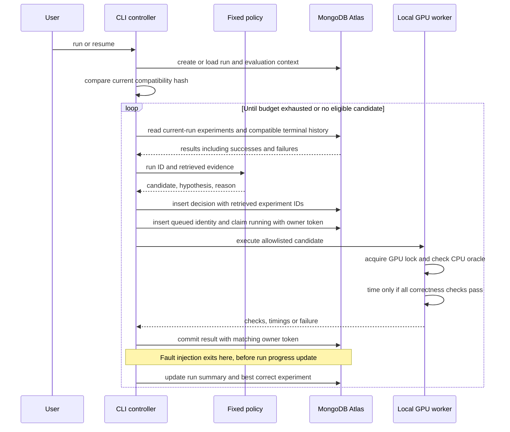
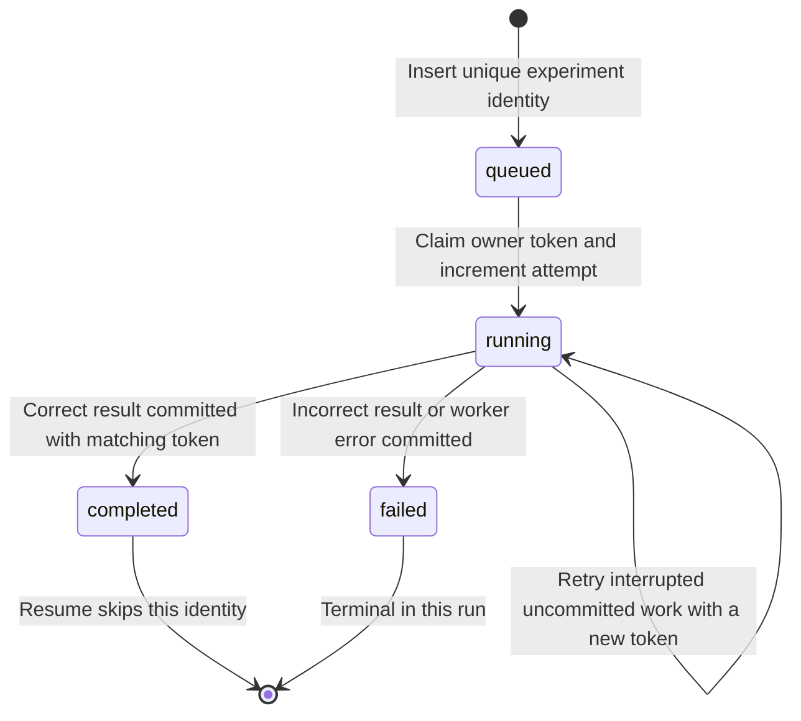

# System design: Atlas GPU Harness

The system preserves experimental evidence across process failure and makes that evidence available before the next GPU action. Its unit of work is a predefined candidate evaluated against one fixed exact top-k contract. It is a deterministic single-host prototype.

## Components and responsibilities

| Component | Implementation | Responsibility |
| --- | --- | --- |
| CLI/controller | `atlas_gpu_harness/__main__.py` | Create/load a run; check compatibility; enforce budget; retrieve history; record decisions; start workers; commit results; rebuild summaries; export JSON. |
| Proposal policy | `atlas_gpu_harness/policy.py` | Apply fixed candidate order, skip this run's terminal candidates, avoid compatible prior correctness failures, and screen unstable sort after a tie failure. |
| Evaluator | `atlas_gpu_harness/evaluator.py` | Fixed inputs and CPU oracle, GPU candidate dispatch, correctness checks, CUDA timing, paired recheck, fingerprints and hardware preflight. |
| Persistence adapter | `atlas_gpu_harness/store.py` | PyMongo operations against Atlas, indexes, experiment identity, owner-token completion guard, history queries, run/decision records. |
| Local files | `artifacts/` | Run and GPU lock files, regenerable JSON exports, local video. Atlas experiment records determine recovered progress. |

`preflight` and `baseline` run locally without Atlas. `run`, `resume`, `status`, and `export` connect to Atlas and perform the connection write/read probe. The controller and worker use the same Python environment. Each evaluation launched by `run` or `resume` uses a fresh subprocess; `baseline` evaluates in the CLI process.

## Control and data flow



The policy never edits the oracle, workload, seed, tolerances, timing protocol, or arbitrary shell commands. Only candidate names from the evaluator's allowlist reach the worker. The five names are `sort_stable`, `argsort_stable`, `packed_topk`, `topk_sorted`, and `sort_unstable`.

## Exact evaluation contract

One contiguous float32 vector of length 16,384, `k=64`, seed `20261011`. Return original indices by descending score and ascending index on ties. The CPU reference uses Python sorting on `(-value, index)`.

Four small cases cover ties, negative values, `k=1`, and `k=n`; the primary seeded workload is checked separately. Incorrect candidates return correctness evidence immediately without timing. Correct candidates receive 10 warmups and 30 CUDA event samples. Input transfer and warmup are outside the timing interval. The nonbaseline recheck collects 12 samples per implementation, alternating which runs first. `speedup_supported` requires the slowest contender sample to beat the fastest baseline sample. This conservative rule is not a statistical confidence interval.

Raw samples and microsecond units are retained, along with median, min, max, and percentile summaries. The correctness suite establishes the tested contract and cases; it does not prove arbitrary shapes, NaNs/infinities, dtypes, or general model correctness.

## Atlas data model

PyMongo connects with `w="majority"` and an 8-second server-selection timeout. The database is `atlas_gpu_harness`.

| Collection | Identity | Important fields |
| --- | --- | --- |
| `runs` | Random UUID string in `_id` | `objective`, `status`, `budget_evals`, `context`, `context_hash`, `policy_version`, `best_validated_experiment`, timestamps. |
| `experiments` | `run_id + ":" + fingerprint({context: context_hash, candidate})` | `run_id`, `context_hash`, `candidate`, `status`, `attempt`, transient `owner_token`, timestamps, `result`. |
| `decisions` | Random UUID string in `_id` | `run_id`, `retrieved_experiment_ids`, `candidate`, `hypothesis`, `reason`, `predicted_outcome`, `policy_version`, timestamp. |
| `health` | Temporary probe ID | Inserted, read and deleted during connection checking. No experimental role. |

`fingerprint` is SHA-256 over JSON with sorted keys. `result` contains `correct`, correctness cases, input/contract hashes, raw and summarized timings if eligible, paired recheck if applicable, or an execution error. Small cases contain expected/actual indices; the main workload stores hashes of those indices.

The full `context` records GPU, VRAM, driver information, Torch/CUDA versions, Python/platform, Git revision, evaluator version, and contract. **The compatibility hash covers only** GPU name, compute capability, Torch version, Torch CUDA version, evaluator version, and contract. It does not enforce identical driver, Git revision, Python version, or uncommitted source state. Update `EVALUATOR_VERSION` when changing evaluator semantics.

MongoDB's standard unique `_id` index provides experiment uniqueness within a run. Additional indexes are:

```javascript
// Created by AtlasStore.init().
experiments: { context_hash: 1, finished_at: -1 }
experiments: { run_id: 1, status: 1 }
decisions:   { run_id: 1 }
```

These are ordinary document indexes. The prototype has no vector or semantic search.

## Retrieval and decision semantics

Before each proposal, the controller asks Atlas for:

```python
experiments.find({
    "context_hash": context_hash,
    "status": {"$in": ["completed", "failed"]}
}).sort("finished_at", -1).limit(50)
```

It then adds any current-run documents absent from that bounded history. The policy uses this evidence as follows:

1. Skip candidates already completed or failed in this run.
2. Skip nonbaseline candidates with a recorded failed correctness check in compatible history.
3. Skip unstable sort if a retrieved correctness failure involved a tie case. This is a conservative hand-written screening rule, not proof that unstable sort failed on the GPU.
4. Otherwise choose the next candidate in the fixed order. A new run always establishes its own stable baseline.

Each selected proposal is stored with the complete list of retrieved IDs. This supplies an audit link to available evidence; it does not assign causal weight to every ID. Skips and the final stop have no separate decision documents. A run's `completed` status means its budget was exhausted or its policy found no further eligible candidate.

`best_validated_experiment` names the correct, timed experiment with the lowest initial median. Consumers must inspect `paired_recheck.speedup_supported` separately before claiming a gain.

## Why the crash demo recovers



`start()` inserts the identity if absent, then claims a `queued` or `running` document. It increments `attempt` and issues a fresh token. It cannot claim an already terminal document. `finish()` updates only a document with the matching identity, `running` state and token. Stale or duplicate completion is rejected.

A per-run local file lock prevents two controllers using the same artifacts directory from driving the same run. A second local lock serializes GPU workers, including a surviving worker whose parent died. GPU lock wait is 120 seconds; subprocess timeout is 180 seconds. Locks provide single-host coordination, not distributed leases.

The completed experiment and the run progress summary are separate writes. `--fault-after-commit` deliberately calls `os._exit(86)` between them. Resume loads the same run, verifies its context hash, reads terminal experiments, skips their candidates, and reconstructs the count and best result. It does not require the stale progress field to be correct.

If the worker executed but its result never reached Atlas, that work can execute again. The guarantee demonstrated is idempotent committed results within a run, not exactly-once GPU execution. Committed timeouts/errors become terminal failures; there is no generic automatic retry policy for those failures.

## Inspect the demonstrated records

In Atlas Data Explorer, select database `atlas_gpu_harness`, then use these collection filters:

| Collection | Filter |
| --- | --- |
| `runs` | `{ "_id": "2eb9f21a2e374f358c4a42b9fbe2258d" }` |
| `experiments` | `{ "run_id": "2eb9f21a2e374f358c4a42b9fbe2258d" }` |
| `experiments` | `{ "run_id": "2eb9f21a2e374f358c4a42b9fbe2258d", "candidate": "topk_sorted" }` |
| `decisions` | `{ "run_id": "21dbac5116a04dafa1ddaed17ea34030" }` |

For the first run, check `attempt: 1` on the stable baseline after resume, then open the failed direct top-k record's `result.checks`. It requires `[0, 1]` but measured `[1, 0]` on the first tie case. For the second run, inspect the first decision's four retrieved IDs and follow the failed experiment reference. Only three candidate experiments exist under its five-evaluation budget.

The [first exported report](evidence/report-2eb9f21a2e374f358c4a42b9fbe2258d.json) and [memory-informed follow-up](evidence/report-21dbac5116a04dafa1ddaed17ea34030.json) permit the same inspection without credentials. Final-state exports show the retained records and attempts; the induced exit and fresh-process recovery procedure are recorded in [EVIDENCE.md](EVIDENCE.md).

## Scope of the evidence

The observed proofs are: a real GPU baseline, actual Atlas persistence, retained completed work after a deliberate crash, rejected incorrect output, and compatible failure history affecting a later run. The five tests cover four isolated controller/store behaviors and one real CUDA packed-key property check. There is no demonstrated general LLM agent, recursive self-modification, distributed recovery, unbounded memory, or repeatable latency improvement.
