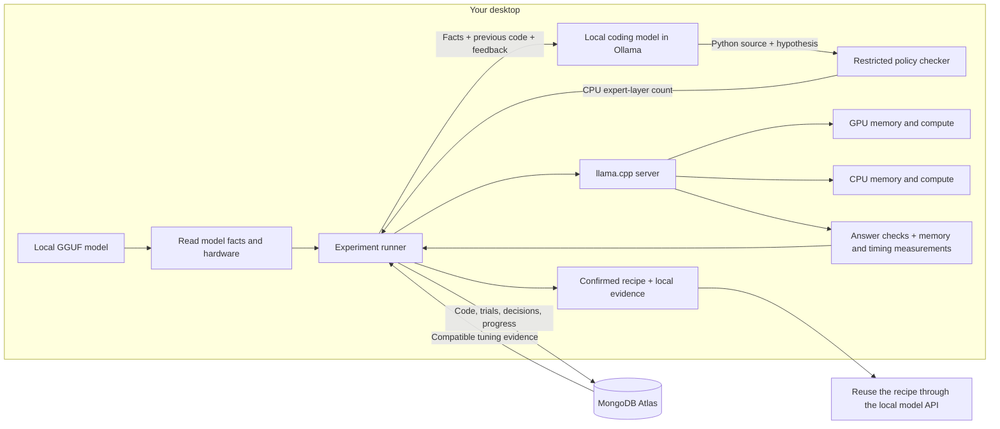
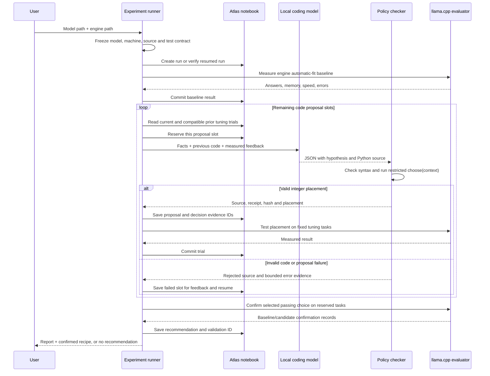
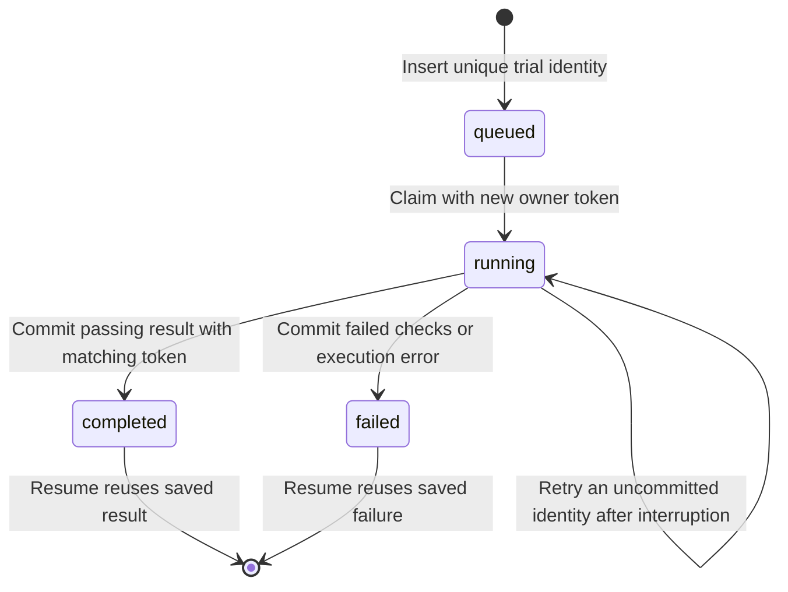

# System design: Atlas GPU Harness

The current system runs a bounded experiment on one desktop: **generate Python code that chooses CPU/GPU expert placement, test that choice on a real MoE model, preserve the evidence, and confirm a reusable recipe**. llama.cpp supplies inference and offload. A local Ollama model supplies proposed code. MongoDB Atlas supplies durable experiment state.

The original PyTorch operator experiment remains a separate CLI path. Its measurements and deliberate-crash demonstration are documented in [EXPERIMENTS.md](EXPERIMENTS.md) and [EVIDENCE.md](EVIDENCE.md). This document describes the consumer inference path.

The newer [deployment engineer](DEPLOYMENT_ENGINEER.md) is a separate path in `atlas_gpu_harness/deployment_engineer.py`: it discovers official runtime documentation, proposes vLLM/SGLang launch experiments from a hardware inventory and prior JSON results, benchmarks a running local endpoint, and compares outcomes. It does not yet write those results to Atlas, generate placement code for those engines, or provide the held-out confirmation and resume guarantees described below. Unsloth is used for artifact preparation guidance, not as a serving engine. Ollama provides the coding model in the existing placement loop only.

## 1. The user problem and system boundary

A model file can be larger than a 16 GB GPU's memory. System RAM can hold some weights, but a usable placement also depends on engine allocations, context memory, speed, and correct outputs. The harness evaluates a supported local model on the actual machine and records the outcome instead of treating an estimated fit as success.

The configurable decision is deliberately small: **how many early layers keep their expert weights on the CPU**. Model weights, quantization, engine, task bank, decoding settings, and evaluation rules stay fixed. The CLI uses physical GPU capacity by default; a lower memory budget is an explicit optional constraint.



Generation finishes before a target-model trial begins; the Ollama request sets `keep_alive: 0`. The target server is owned by the runner and stopped after each trial. Atlas hosts no GPU computation.

## 2. Components

| Component | File | Responsibility |
| --- | --- | --- |
| Model and hardware inspection | `atlas_gpu_harness/model_probe.py` | Read GGUF metadata, inspect one visible NVIDIA GPU and Linux-visible RAM, validate architecture, estimate an initial offload count. |
| Experiment runner | `atlas_gpu_harness/inference.py` | Freeze context, establish baseline, enforce proposal budget, retrieve feedback, run trials, confirm a choice, persist/export a recommendation. |
| Coding proposer and checker | `atlas_gpu_harness/policy_codegen.py` | Ask local Ollama for Python, validate syntax, execute the restricted policy, retain source and failure evidence. |
| Inference evaluator | `atlas_gpu_harness/inference_backend.py` | Launch llama.cpp, check readiness, run fixed tasks, sample memory, retain answer/timing records, stop the owned server. |
| Atlas storage | `atlas_gpu_harness/store.py` | Majority writes, compatible-history retrieval, experiment ownership checks, runs and decisions. |
| Recipe launcher | `atlas_gpu_harness/inference_serve.py` | Verify saved confirmation and compatibility; launch the recorded recipe without repeating search. |
| Engine setup | `scripts/setup_inference_engine.py` | Install checksum-pinned llama.cpp b11429/runtime assets locally; verify engine version and CUDA visibility. |

The metadata allowlist is `qwen35moe`, `qwen3moe`, and `kimi-linear`; input must be a single-file GGUF with expert metadata. Engine architecture support is necessary, but a passing real trial establishes operability. The prototype does not download arbitrary models, convert weights, support every MoE architecture, or coordinate multiple GPUs. The separately acquired Qwen3-30B-A3B and Kimi-Linear-48B-A3B Q4_K_M files have verified full SHA-256 checksums in the [model manifest](evidence/inference-models.json); their acquisition is distinct from proving inference works.

## 3. One complete run



Default search budget is **three slots: one baseline and two code proposals**. Invalid or interrupted proposals consume slots. Confirmation is a separate cost of up to four server launches. Completed runs return the saved recommendation.

### What code is generated?

The proposer requests JSON with exactly `hypothesis` and `code`. Python must define `choose(context)` and return exactly `{"n_cpu_moe": integer}`. This illustrative valid policy uses the estimated starting point; actual generated source and revisions are retained in each run:

```python
def choose(context):
    estimated = context["feedback"]["initial_estimate_n_cpu_moe"]
    blocks = context["model"]["block_count"]
    return {"n_cpu_moe": min(blocks, max(0, estimated))}
```

The function may condition its choice on observed memory, trial outcomes, and previous source. It executes once against the supplied context, producing one recipe. Its algorithm and chosen setting are auditable. It cannot edit scoring code or the engine.

### What may the proposer see?

- Model name, architecture, block/expert counts, and file size.
- Fresh GPU, RAM, CPU, platform, and disk facts.
- Current-run tuning summaries and up to eight compatible prior-run tuning summaries.
- Objective, budget, initial estimate, tried placements, bounded errors, and previous generated code when available.

The storage query considers the latest 50 compatible terminal experiments, then filters prior-run records to tuning. All current-run terminal tuning trials are included separately. This is bounded exact-context retrieval without vector search. Confirmation outcomes never enter this feedback. Duplicate placements are discouraged in the prompt; different slots can still choose the same value.

## 4. Generated-code execution boundary

The endpoint is local Ollama at `127.0.0.1:11434/api/generate`, default model `gemma3:12b`. Requests use JSON output, nonstreaming generation, temperature zero, a 600-token output limit, and `keep_alive: 0`. Local requests bypass HTTP proxies. No substitute policy is silently generated when Ollama fails.

| Allowed | Rejected |
| --- | --- |
| One undecorated `choose(context)` function; local assignments, `if`, `return`. | Imports, attributes, nested functions, loops, comprehensions, decorators, annotations. |
| Arithmetic, comparisons, Boolean operations, dictionaries and indexing. | Context mutation, dunder access, unpacking, recursion, other syntax. |
| Calls to `min`, `max`, `int`, `len`. | File, network, shell, environment, and arbitrary function calls. |
| One integer from zero through the model's block count. | Boolean, out-of-range, malformed, or extra-key results. |

Code is limited to 8,000 characters and 400 AST nodes; context to 32 KiB, screened for obvious credential fields and MongoDB URIs. The subprocess uses Python `-I -S`, an empty environment, temporary working directory, and a three-second timeout. Linux CPU, address-space, open-file, file-size, and core limits also apply. This boundary is designed for the admitted placement language, not arbitrary Python.

Source, SHA-256, hypothesis, proposer metadata, raw response, context, and policy result are saved locally. Successful proposals are stored on the Atlas run. Failed proposals retain available code/hash/path and bounded actual error details in Atlas so a later slot can repair the failure.

## 5. Baseline and controlled comparison

Both arms use the same trusted local engine and unchanged GGUF. The [pinned llama.cpp server options](https://github.com/ggml-org/llama.cpp/blob/b11429/tools/server/README.md) provide these existing mechanisms:

| Arm | Placement flags |
| --- | --- |
| Baseline | `--gpu-layers auto --fit on --fit-target M` |
| Generated candidate | `--gpu-layers all --n-cpu-moe N --fit off` |

`M = max(1024, physical_total_mib - budget_mib)`. The physical-card default still gives the engine a minimum 1,024 MiB automatic-fit margin. A candidate keeps the first `N` layers' expert weights on the CPU; other offloadable weights remain eligible for GPU placement. The initial estimate assumes model bytes are spread evenly across layers and reserves 2,048 MiB. It is a starting guess, not a fit guarantee.

Both arms use 4,096 context tokens, one server slot, eight inference/batch threads, memory-mapped weights, disabled prompt cache, temperature zero, a fixed seed, and at most 96 output tokens per answer. Both request `--chat-template-kwargs '{"enable_thinking":false}'` and append `/no_think` to task prompts. Whether those requests disable reasoning depends on the model's chat template; Kimi's template ignores the `enable_thinking` flag. The fixed request settings therefore do not establish that thinking was disabled. A fixed warmup question precedes scoring. Exact commands and server logs are retained. The current backend allows up to 600 seconds for server readiness and defaults to physical GPU capacity when no budget is supplied.

### Measures and acceptance

Tuning runs six exact-answer tasks twice, reversing question order in the second pass. They cover arithmetic, field extraction, and reading simple Python expressions. Model output is not executed. Scoring parses JSON and requires one `answer` key with the exact expected value and type.

Each trial records raw/expected answers, pass/fail, usage, engine timings, full nonstream request latency, median decode tokens/second, sampled GPU memory and process RSS, readiness, final health, load/wall time, and errors. Request latency is **not time to first token**.

`correct` means **engine_success AND quality_pass AND resource_pass**. Tuning requires 12/12 checks; confirmation requires 4/4. The sampled peak must remain at or below the budget. Sampling every 250 ms includes other GPU processes and startup, and can miss brief peaks. It is an observation rule, not an allocator-enforced limit.

### Selection and confirmation

Select the passing tuning trial with the highest median decode rate. If it is the baseline, run one reserved baseline confirmation. If it is a generated candidate, use:

```text
Block 1: baseline → candidate
Block 2: candidate → baseline
```

Each fresh server answers the same four reserved questions. For each question, percentage change is `100 × (candidate_rate / baseline_rate - 1)`. A block's effect is the median of those four changes. Accept a directional speed gain only when **both arms pass in both blocks, and each block's median gain exceeds 5%**.

Otherwise, two passing baseline confirmations retain the baseline. If the baseline does not pass both confirmations but the candidate does, the current runner can retain the candidate for feasibility with speedup unproven. Failure can mean an answer, startup, or memory failure; inspect the error before describing a capacity improvement. If neither choice is confirmed, the recommendation has `recipe: null`. New runs record an explicit `selection_reason` alongside the validation ID.

This is a small descriptive protocol, not a confidence interval, general quality benchmark, randomized multi-machine study, or proof that learned policies outperform a parameter sweep. Concurrent downloads, other GPU use, and short answers can distort speed results. Current outcomes and conditions belong in [INFERENCE_RESULTS.md](INFERENCE_RESULTS.md).

### Completed 35B example

Run `b88ec5bd304443a3add2b2fa767e2450` completed all seven trials: three tuning runs passed 12/12 checks each, and four confirmation runs passed 4/4 each. The two coding attempts generated identical source, both choosing zero CPU expert layers. The chosen candidate's paired confirmation gains were +3.5647% and +1.9202%, below the fixed 5% rule, so the saved recommendation retained `engine_autofit`. This run demonstrated the measurement and rejection path, without a successful policy revision or confirmed speedup. Its 11.39 GB UD-IQ2_M file also does not prove weights larger than VRAM. The [raw report](evidence/inference/b88ec5bd304443a3add2b2fa767e2450.json) preserves the original source context and measurements; later source changes do not rewrite those records.

## 6. Atlas data and identities

PyMongo uses `w="majority"` and an eight-second server-selection timeout. Database: `atlas_gpu_harness`. Startup performs a ping and temporary write/read/delete health probe.

| Collection | Identity and contents |
| --- | --- |
| `runs` | UUID `_id`; workflow, objective, context/hash, budget, proposer model, proposals, proposal attempts/errors, status, recommendation, best validated experiment. |
| `experiments` | `_id = run_id + ":" + SHA256({context, name, recipe, stage})`; candidate, context hash, status, attempt, transient owner token, timestamps, full result. |
| `decisions` | UUID `_id`; run, candidate, hypothesis, reason, retrieved experiment IDs. |
| `health` | Temporary startup probe only. |

Trial identity distinguishes tuning from confirmation and repeated confirmation launches. Committed terminal identities are reused on resume. Different proposal names can choose the same placement, so identity is not a global placement deduplicator.

New inference runs and decisions record `policy_version: local-model-codegen-v1`; generated source and proposal receipts provide the detailed provenance. Earlier exported reports retain the metadata written by their original code revision.

Ordinary MongoDB indexes support retrieval:

```javascript
experiments: { context_hash: 1, finished_at: -1 }
experiments: { run_id: 1, status: 1 }
decisions:   { run_id: 1 }
```

Atlas is on the execution path: the next proposal reads compatible history, failed slots remain consumed after restart, committed trials are reused, and the selected result references a passing confirmation. Retrieved IDs record which evidence was available; they do not prove every record influenced the model's reasoning.

### Inspect a run in Atlas

Select `atlas_gpu_harness` in Data Explorer, substituting the printed run ID:

| Collection | Filter |
| --- | --- |
| `runs` | `{ "_id": "RUN_ID" }` |
| `experiments` | `{ "run_id": "RUN_ID" }` |
| `experiments` | `{ "run_id": "RUN_ID", "result.stage": "holdout" }` |
| `decisions` | `{ "run_id": "RUN_ID" }` |

Read generated source/hashes in `runs.proposals`, rejected code in `proposal_errors`, and commands, answers, memory samples, and timings in experiment results. Follow `recommendation.validated_experiment_id` to the passing confirmation. The completed physical-card 35B run is `b88ec5bd304443a3add2b2fa767e2450`; see the [result ledger](INFERENCE_RESULTS.md) for additional runs. The owner confirms the cluster was created through the event's Atlas invitation; Sandbox membership has not been independently checked through the Atlas UI.

For decision-to-result inspection, run the read-only [aggregation pipeline](queries/decision-evidence.json) against `decisions`, replacing `REPLACE_WITH_RUN_ID` in its first stage. Its `$lookup` joins `retrieved_experiment_ids` to experiment records and projects the answer, memory, speed, and error evidence. The [CLI helper](scripts/show_atlas_evidence.py) runs the same query with `--run-id RUN_ID`; it creates no indexes, health records, or Atlas UI saved query.

## 7. Compatibility, resume, and failure

The evaluation context hash covers:

- GGUF header-and-file-size identity plus model modification time.
- Engine reported version and launcher SHA-256.
- GPU name, memory and driver; CPU count and Linux-visible RAM total.
- Contract version, context capacity, budget, and both task banks.
- Source hashes for the runner, backend, model probe, and policy generator.

The GGUF identity **does not hash all tensor weights**. Engine identity does not hash every shared library. Current GPU occupancy, disk activity, thermal state, and all background load are not frozen by the hash. These are practical compatibility checks with stated limits.

One local `artifacts/gpu.lock` serializes harness inference and saved-recipe launches using the same workspace. It is a host-local lock, not a distributed lease.



`finish()` accepts only the matching running identity and ownership token. Stale completion is rejected. Failed and completed trials are terminal. Startup failures such as an occupied port are recorded; the harness does not stop an unknown process to free that port.

Proposal slots are reserved as `running` before calling Ollama, then become `completed` or `failed`. A reserved but uncommitted proposal becomes `interrupted` on resume and remains consumed. Restart cannot silently expand the generation budget.

If an engine trial ran but its result never committed, resume may execute it again. There is no exactly-once GPU-execution guarantee. Normal completion and handled errors clean up the owned child. A force-killed parent can leave a server behind; automatic orphan recovery is not implemented. The original top-k fault-injection demo does not prove every inference failure path.

## 8. Reusing a confirmed recipe

The runner exports under `artifacts/inference/RUN_ID/`:

```text
policy-*.py                  generated source
policy-*.json                context, proposer and validation receipts
*.server.log                 actual engine output
baseline.json / policy_*.json / holdout_*.json
report.json                  run, experiments and decisions
recommendation.json          recipe and passing confirmation ID
```

`inference_serve` loads the recommendation and sibling report. It verifies agreement, context hash, successful matching confirmation, backend contract/source, model identity/mtime, launcher/version, GPU/driver, CPU count, and RAM total. It reconstructs and compares the successful command, permitting a port change.

The launcher takes the GPU lock and starts the server. Its printed API URL becomes usable after engine loading; printing the URL is not a readiness check. It does not repeat search or require Atlas. Ctrl+C terminates the owned child. Local records are reproducibility evidence, not signed attestations.

## 9. Scope and credit

The harness automates a constrained coding-and-measurement workflow for supported local MoE files. Existing engines and quantized artifacts supply the actual ability to run large models. [Strata and Project Maya](STRATA_MAYA_RESEARCH.md) suggest richer per-expert VRAM/RAM/SSD policy mechanisms; neither is integrated or benchmarked by this repository.

The 4,096-token context and bounded Atlas retrieval provide experiment continuity, not a billion-token context window. Policy revisions are a limited form of adaptation; the harness does not rewrite its architecture or guardrails. [README.md](README.md), [HACKATHON_REVIEW.md](HACKATHON_REVIEW.md), and [INFERENCE_RESULTS.md](INFERENCE_RESULTS.md) connect the mechanism to the pitch, criteria, and measured outcomes.
