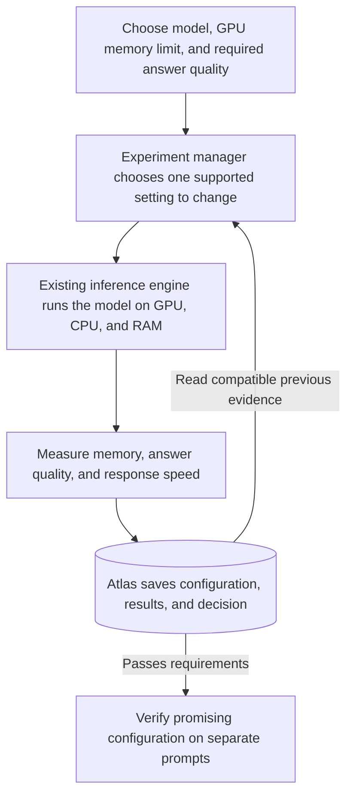

# Consumer-GPU inference: corrected goal and required proof

**Status: proposed integration and experiment protocol. No results in this document establish improved LLM inference.**

## The user's goal

Run a capable language model locally when the whole model and its conversation state cannot fit in a consumer graphics card's memory. Find a configuration that fits the machine, produces acceptable answers, and responds at a useful speed. Preserve the experimental evidence so subsequent work can build on it.

The optimization target is the complete inference workload. Faster individual GPU operations are useful only when their effects reach that workload. Improving answer quality itself would require a separate quality result; this goal starts with retaining measured quality while reducing hardware requirements or improving speed.

## Where the current build diverged

The original supplied plan named Strata's standalone `qsa_select_bench`, allowed a PyTorch operator fallback after a setup timebox, and explicitly excluded full inference-engine installation and large model downloads. The implementation used that fallback. No Strata or Maya code was integrated, no LLM was run by this harness, and no model quality or model memory reduction was measured.

The existing prototype establishes Atlas persistence, recovery after a particular interruption, independent operator correctness checks, repeated GPU timing, and fewer repeated failed experiments. Its 25% reduction concerns experiment attempts on top-k. It does not establish the clarified product outcome.

## What the inspirations actually provide

- **Strata:** its documented design keeps frequently used model experts on the GPU and computes other experts from system RAM on the CPU. Other state can use RAM/storage. The model's mixture-of-experts structure makes selective placement possible. [Source: Strata architecture](https://github.com/Niko1221/Strata/blob/main/docs/HOW_IT_WORKS.md).
- **Project Maya:** built on Strata, with GPU/RAM/SSD expert tiers and quantized model packs. Its calibration already measures configuration choices on the user's hardware. [Source: Maya overview](https://github.com/mw00/project-maya), [calibration and settings](https://github.com/mw00/project-maya/blob/main/docs/SETTINGS.md).

These techniques reduce the amount that must live in GPU memory at once; system RAM, storage, data movement, and CPU performance still matter. Supported models and mechanisms differ between the two engines. Their published performance numbers are upstream claims, not measurements on this desktop.

Our useful extension would be a reproducible comparison of configurations with explicit quality and resource requirements, a separate final evaluation set, and persistent evidence across sessions. Maya's existing calibration must be acknowledged and used as a meaningful comparison where applicable. A wrapper alone does not establish an improvement over the engine.

## Proposed system design

The engine executes the neural network. The harness launches trials and judges their outcomes. Atlas stores experiments; it is not the model's GPU memory or attention cache. The engine adapter, model-level evaluator, and resource collector shown above still need implementation.

## Establish a meaningful baseline

Pin one engine revision, one model weight revision and quantization, one tokenizer, and one machine. Use the engine's recommended configuration as the first baseline. If evaluating a replacement for Maya's calibration, include Maya's calibrated configuration as a baseline too.

Freeze prompt texts, prompt lengths, decoding settings, output limits, concurrency, warmup, and scoring before tuning. Save a separate set of prompts for final confirmation. Compare configurations inside the same engine and model first; comparing different models across Strata and Maya would not isolate a configuration's effect.

| Question | Measurement | What qualifies as evidence |
| --- | --- | --- |
| Does it fit? | Observed peak GPU memory, peak system RAM, and failures at a declared context length | Completion within the declared resource limits; also account for memory outside the Python allocator. |
| Is it useful? | Time to first token and output tokens per second, with actual output length | Repeated improvement against the functioning baseline without exceeding quality/resource limits. |
| Are answers preserved? | Fixed task accuracy or coding tests; optionally token/logit comparisons | Meets a quality threshold and allowed regression fixed before seeing candidate results. Fluent-looking text is insufficient. |
| Does it support longer context? | Successful prompt lengths, memory use, and task accuracy at those lengths | More usable context while satisfying the same quality and response requirements. |
| Does experiment memory help? | Same search budget and candidates, history on/off | Better accepted configurations or fewer trials for the same result, including the cost of acquiring history when claiming total savings. |

If an all-on-GPU configuration runs out of memory, record that as a capacity result. Use a functioning offloaded configuration for speed comparisons; an out-of-memory run has no generation rate from which to compute a speedup.

## Smallest controlled experiment

1. Select a model already available locally and an engine that supports it. A small-model trial can validate the adapter; it cannot establish that a Strata/Maya-scale model runs here.
2. Record a functioning baseline's memory, response timings, and answer scores. Choose a memory limit and a quality floor appropriate to that model before candidate collection.
3. Change one supported memory-placement or cache setting while keeping model weights fixed. If quantization changes, treat it as a separate experiment and measure its quality effects explicitly.
4. Repeat baseline/candidate comparisons across several prompts with balanced or randomized order. Restore equivalent cache state between conditions and report cold-start and warmed results separately. Repeating only the same cached prompt can exaggerate performance.
5. Save each configuration, environment, raw measurement, output, score, error, and evidence-linked decision in Atlas. Record engine/model revisions in compatibility, rather than relying on the operator prototype's existing context hash.
6. Re-evaluate any selected configuration on the untouched final prompts and remeasure the baseline nearby. Report tradeoffs even when no candidate improves.

Success is a measured configuration meeting the GPU memory and quality requirements, with a demonstrated capacity or speed advantage against the declared baseline. The current top-k and history experiments cannot substitute for that result.

## Available starting point on this desktop

A read-only inventory found complete cached weights, configuration, and tokenizer files for Llama-3.2-1B-Instruct, Llama-3.2-3B-Instruct, and Qwen2.5-3B-Instruct. PyTorch, Transformers, and Safetensors are installed. No model was loaded in this audit, so successful inference remains unverified.

The smallest next implementation milestone is to run the cached 1B model with a pinned revision and record a complete inference baseline in Atlas. Established framework options can then validate the evaluator. Any comparison with an intentionally inefficient reference must also include the normal optimized configuration before claiming a deployment improvement. This small model validates the experimental path; it does not reproduce Strata or Maya's large-model capability.

The desktop's physical card has 16 GB of VRAM. An enforced smaller allocation limit is a simulated capacity constraint on that card, not a measurement on a physical 6 GB or 8 GB GPU.

## Long context and experiment history

Long context concerns how much prompt/conversation information the running model can use. Its attention state consumes memory and must be evaluated with real long inputs and tasks that depend on that input. Atlas experiment history concerns what the experiment manager remembers between trials. They are different mechanisms; implementing the second does not prove the first.
