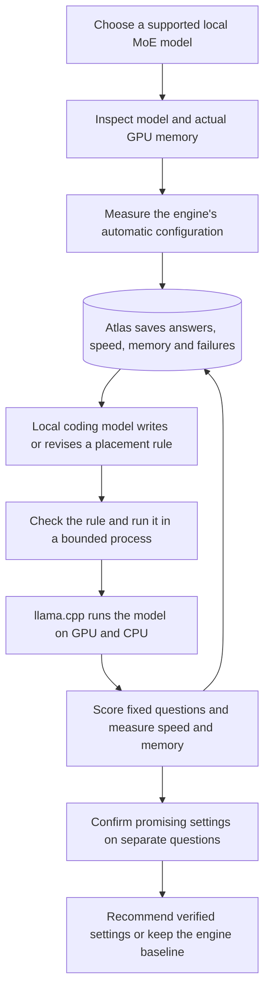

# Consumer GPU inference: the implemented harness and required proof

## The problem and the product

A developer sees a promising new language model, then discovers that the model is larger than the memory on their graphics card. Quantized weights and moving computation into system RAM can make local use possible. The remaining work is often trial and error: which settings fit, how slow are they, and do answers still pass the required checks?

**Atlas GPU Harness turns that setup task into measured experiments.** Give it one supported local MoE model and a GPU memory budget. It measures the engine's automatic configuration, asks a local coding model to write a small placement policy, tests the policy, returns measurements as feedback, and saves the evidence in Atlas. It can retain the existing engine configuration when the generated policy does not improve it.

Current evidence establishes real model execution and a working policy-generation loop. Improvement over the engine must come from the comparison results; starting a large model alone is not such an improvement. See [INFERENCE_RESULTS.md](INFERENCE_RESULTS.md) for the current results and [INFERENCE_SETUP.md](INFERENCE_SETUP.md) for setup.

## Implemented system

| Component | What it does today |
| --- | --- |
| `model_probe.py` | Reads GGUF metadata, checks a small architecture allowlist, inspects GPU/RAM, and makes a starting estimate. The estimate does not prove fit. |
| `policy_codegen.py` | Uses local Ollama to generate an actual Python `choose(context)` function. Later proposals receive earlier code, measured results, and validation errors. |
| `inference_backend.py` | Starts an owned llama.cpp process, warms it, scores exact-answer tasks, samples memory, records timings/errors, and stops the process. |
| `inference.py` | Runs the baseline, bounds the proposal budget, persists trials/proposals, confirms a selected configuration, and resumes compatible saved work. |
| MongoDB Atlas | Stores runs, experiments, decisions, generated proposals, errors, and recommendations. Compatible tuning history is retrieved before the next proposal. |

The generated policy can choose only `n_cpu_moe`: how many initial layers keep their experts in CPU RAM. Imports, filesystem/network calls, loops, attributes, and arbitrary function calls are rejected. The evaluator and acceptance rules stay fixed. This is a constrained policy language with a bounded worker, not a general-purpose Python sandbox.

The model allowlist currently covers `qwen35moe`, `qwen3moe`, and `kimi-linear`; an entry is a compatibility candidate, not proof that every model in that family works. A local single-file GGUF and compatible engine are required. Arbitrary newly released architectures and unverified quantizations are not automatically supported.

## A fair baseline

The baseline is **llama.cpp b11429's automatic placement and fit behavior**, using the same model file and task contract as each candidate. It uses `n_cpu_moe: null`, GPU layers `auto`, and fitting enabled, with a fit target leaving at least 1,024 MiB of device margin.

Generated candidates explicitly select their CPU expert layer count, with other layers placed on the GPU and automatic fitting disabled. This asks whether a generated placement policy beats the engine's normal policy. Between generated candidates, the only tunable setting is `n_cpu_moe`.

The default limit is the card's **physical 16,303 MiB capacity**. An optional smaller `--gpu-budget-mib` is a declared simulated constraint on the same physical card. Earlier 10,000 MiB trials are development evidence, not measurements on a physical 10 GB card or the main capacity result.

## Experimental design and acceptance

The contract fixes model weights and quantization, engine revision, machine, context allocation of 4,096 tokens, concurrency one, eight CPU threads, deterministic decoding, and output limit. Each fresh engine process receives a separate warmup question. Prompt caching is disabled. The readiness timeout is now 600 seconds for larger models; waiting longer is not evidence that a model runs successfully.

| Measurement | Current protocol | Claim boundary |
| --- | --- | --- |
| Answer checks | Six tuning questions, repeated in reversed question order: 12 scored responses. All must return the exact expected JSON answer. | Six unique small arithmetic, extraction and code-reading tasks; not a general model-quality benchmark. |
| GPU memory | Sample total device usage every 0.25 seconds, including model startup and other processes. Peak sample must stay within budget. | Short peaks can be missed. Observation, not an allocator-enforced limit. |
| CPU memory | Sample the engine process's resident memory. | Process RSS is not total host RAM consumption or an exact accounting of mapped weights. |
| Speed | Engine-reported decode tokens/second, actual token counts, load time, and complete-request latency. | Complete-request latency is not time to first token; answers are short. |
| Confirmation | Four separate questions hidden from the coding model; compare baseline→candidate, then candidate→baseline. | A descriptive two-block check, not a calibrated confidence interval or broad workload study. |

A speed improvement is accepted only if both confirmation blocks pass answer/resource checks and each block's median paired decode improvement exceeds 5%. A passing baseline is retained when a candidate fails that rule. If a candidate passes both held-out runs and the baseline does not pass both, the code can retain the candidate as a feasibility result; inspect the actual failure before calling that a capacity improvement. The saved recommendation includes a selection reason based on held-out evidence, not merely the tuning result. Concurrent downloads or other machine activity can confound timings and must be disclosed.

Context identity includes the contract, source hashes, hardware facts, engine version/launcher hash, and model metadata identity/mtime. Model identity hashes its GGUF header and file size; it is explicitly **not a full weight checksum**. Context changes prevent an incompatible resume.

## Current evidence and the larger-model goal

The cached **Qwen3.5-35B-A3B**, Unsloth `UD-IQ2_M` GGUF, is 11.39 GB on disk. Physical-capacity run `b88ec5bd304443a3add2b2fa767e2450` completed all seven trials with answer/resource checks passing. Each tuning trial scored **12/12 responses from six unique tasks**. The selected candidate produced **+3.5647% and +1.9202%** median paired decode changes on the two held-out comparisons, below the fixed >5% rule. **The harness retained engine auto-fitting; no improvement was established.** Concurrent downloads also limit speed interpretation. The file is smaller than VRAM, so this establishes real 35B inference but not larger-than-VRAM capacity.

The official Qwen 30B Q4_K_M file (**18,556,685,824 bytes**) and third-party Bartowski Kimi Linear 48B Q4_K_M file (**30,061,058,720 bytes**) are fully downloaded. Their full-file SHA256 checksums were verified separately; repositories, revisions and hashes are recorded in [the model manifest](evidence/inference-models.json). At this update the Kimi inference run has started, but completed larger-model results remain pending. Download completion is not inference proof; consult [INFERENCE_RESULTS.md](INFERENCE_RESULTS.md) for the latest measured status.

The earlier top-k result remains separate historical evidence: Atlas memory reduced repeated operator evaluations from four to three in two comparisons. That 25% result is not LLM speed, compression, quality, or capacity improvement. See [EXPERIMENTS.md](EXPERIMENTS.md).

## Inspirations and limits

[Strata](https://github.com/Niko1221/Strata/blob/main/docs/HOW_IT_WORKS.md) and [Project Maya](https://github.com/mw00/project-maya) inspired large MoE inference across GPU, CPU, RAM and storage. Their implementations and published performance belong to those projects. This build uses official llama.cpp; it does not integrate or reproduce Strata or Maya. Maya already provides hardware calibration, and llama.cpp already provides automatic fitting. Our contribution is the bounded generated-policy/measurement/feedback loop and persistent evidence, evaluated against existing capabilities.

No new CUDA kernel, model training, quantization algorithm, or arbitrary model conversion is implemented. Production cost savings and user adoption have not been measured.

Long context concerns useful answers from long inputs. The current 4,096-token allocation and short questions do not establish long-context performance. Atlas history supplies memory across experiments; it is not the model's attention cache or a billion-token reasoning session.

## Verification and event environment

The current local test suite passed **46 tests**. This supports the tested code paths; the real model records establish inference behavior. On October 11, 2026, the user confirmed that the Atlas environment was created through the event invitation. This is user-confirmed Sandbox provenance, not independent browser/UI verification.
