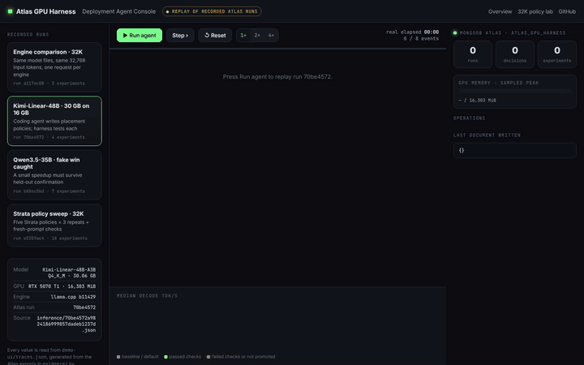
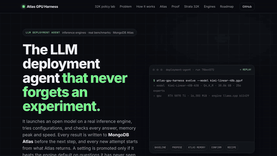
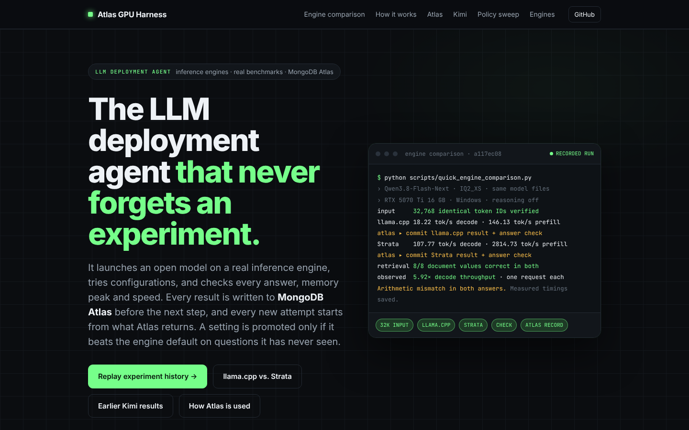
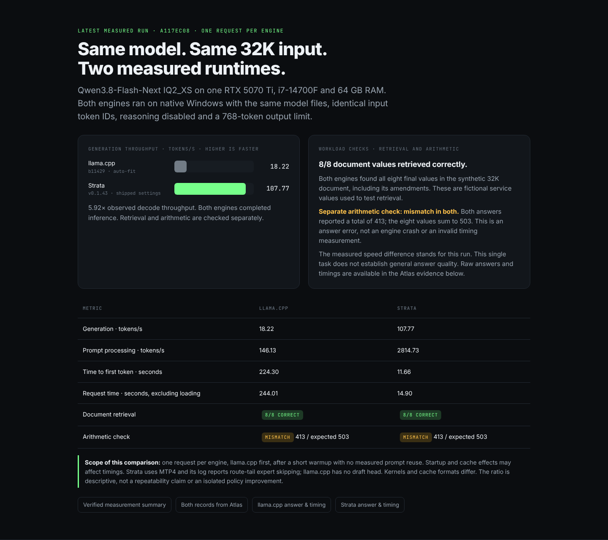
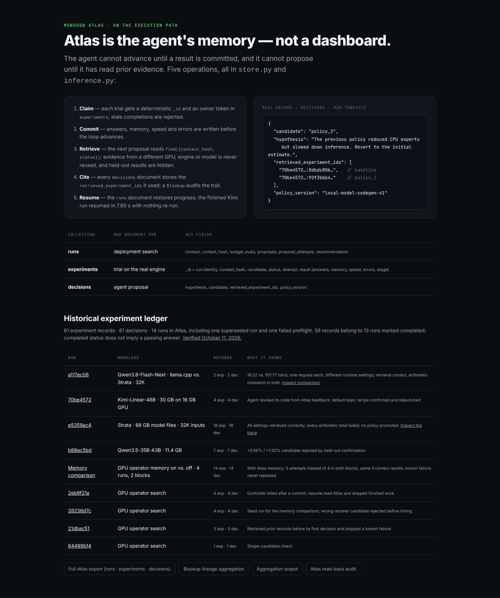
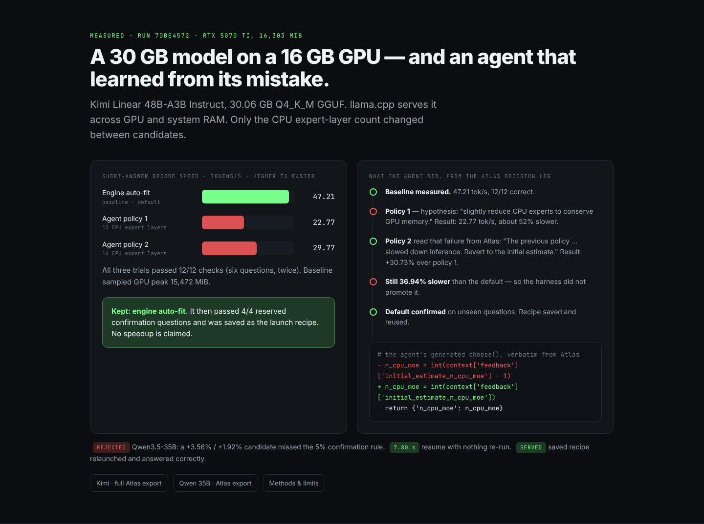
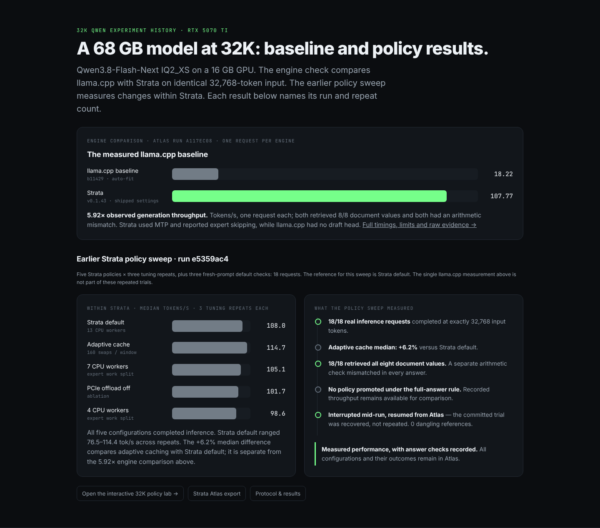
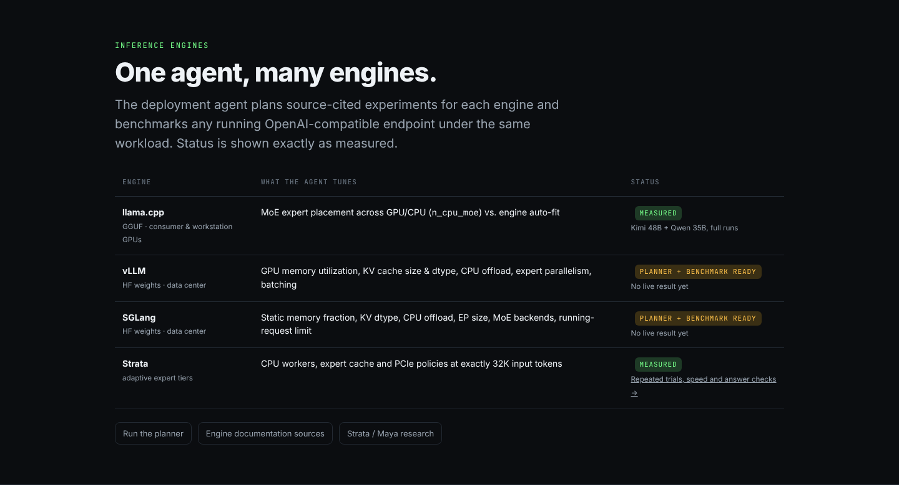
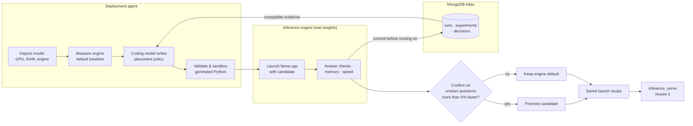

# Atlas GPU Harness

**An LLM deployment agent: it runs open models on real inference engines, benchmarks every configuration for correctness, memory and speed, and records each experiment in MongoDB Atlas — so a setting reaches production only when the evidence holds.**

**[▶ Agent console (replays recorded Atlas runs)](demo-ui/app.html)** · [offline copy — download and double-click](demo/agent-console-offline.html) · [Overview site](demo-ui/index.html) · [32K Strata policy lab](demo-ui/strata.html) · [59-second video](demo/atlas-inference-demo.mp4) · [Measured results](INFERENCE_RESULTS.md) · [System design](ARCHITECTURE.md) · [Submission](SUBMISSION.md)

[](docs/screenshots/agent-console-kimi.mp4)

<sub>Agent console replaying recorded Atlas run 70be4572 (Kimi-48B, 30 GB on a 16 GB GPU). Click for the full-quality video.</sub>



<sub>Full-resolution scroll recording: [demo-scroll.mp4](docs/screenshots/demo-scroll.mp4)</sub>

| Overview site: recorded run a117ec08 | Same model, same 32K input: llama.cpp vs. Strata |
| --- | --- |
|  |  |
| **MongoDB Atlas as the agent's memory** | **30 GB Kimi model on a 16 GB GPU** |
|  |  |
| **68 GB model at 32K: baseline and policy sweep** | **Inference engines** |
|  |  |

[The problem, with sourced numbers](docs/screenshots/03-problem.png) · [Interactive 32K Strata policy lab](docs/screenshots/08-strata-policy-lab.png)

| | |
| --- | --- |
| **Latest measured comparison** | **Qwen3.8-Flash-Next at 32K input: llama.cpp 18.22 tok/s, Strata 107.77 tok/s — 5.92× observed generation throughput.** One request per engine, same weights and input, reasoning off. Different runtime optimizations; not a harness-generated policy gain. |
| **Earlier Kimi result** | A 30.06 GB model served on a 16 GB RTX 5070 Ti. Every tuning trial passed 12/12 checks; the selected engine default passed 4/4 unseen confirmation questions. |
| **Agent behaviour** | The coding agent read its own failure from Atlas and rewrote its policy (+30.73% over its first attempt). That was still 36.94% slower than the engine default, so the harness kept the default. |
| **Honesty gate** | On Qwen3.5-35B-A3B, a +3.56% / +1.92% "speedup" missed the 5% confirmation rule and was rejected. **No unproven speedup is ever promoted.** |
| **Durability** | Resuming a finished run returns its saved recipe from Atlas in 7.80 s without re-running anything; the saved recipe relaunches and serves correct answers. |

## Latest: llama.cpp versus Strata at 32K

Same Qwen3.8-Flash-Next IQ2_XS files and 32,768 input token IDs, native Windows, RTX 5070 Ti 16 GB, i7-14700F and 64 GB RAM. Reasoning disabled; one request per engine.

| Metric | llama.cpp b11429 | Strata v0.1.43 |
| --- | ---: | ---: |
| Generation, tokens/s | **18.22** | **107.77** |
| Prompt processing, tokens/s | 146.13 | 2,814.73 |
| First token, seconds | 224.30 | 11.66 |
| Request time excluding loading, seconds | 244.01 | 14.90 |
| Document retrieval | 8/8 correct | 8/8 correct |

**5.92× observed decode throughput in this run.** Both engines completed inference and retrieved every final document value, but both reported 413 for a separate arithmetic total whose correct value is 503. These are fictional service values in a synthetic document, not engine settings.

Strata used MTP4 and reported route-tail expert skipping; llama.cpp had no draft head. Kernels and cache formats differ. The first measured long request after a short warmup may include startup/cache effects. This is a descriptive runtime comparison, not a repeatability claim, proof of equivalent output quality or a generated-policy improvement.

[Comparison GUI](demo-ui/index.html#comparison) · [Verified measurements](evidence/engine-comparison/summary.json) · [Atlas records and raw answers](evidence/engine-comparison/latest.json) · [Reproduction runner](scripts/quick_engine_comparison.py)

**Atlas inventory:** 61 experiment records and 61 decisions across 14 runs, including one superseded run and one failed preflight. Of these, 58 records belong to 13 runs marked completed; that status includes the preflight and does not mean every trial passed. [Read-back count audit](evidence/engine-comparison/atlas-counts.json).

## Earlier 32K Strata policy sweep

On the same RTX 5070 Ti, native Strata runs Qwen3.8-Flash-Next at **32,768 input tokens** across five documented CPU, cache, and PCIe policies. Adaptive caching was 6.2% faster than default, but every trial failed the arithmetic check, so nothing was promoted. Atlas holds the answers and timings; the UI reads them back. [Protocol and measured results](STRATA_EXPERIMENT.md).

Long inputs and long experiment histories are separate capabilities: this suite exercises 32K inputs, while Atlas preserves continuity across restarts. Ollama is not an inference target; it remains the earlier coding loop’s model provider. Maya remains a research target.

## Why this matters

Today, LLM infrastructure engineers tune deployments **by hand, or prompt by prompt with a chat assistant** that cannot run anything, cannot verify an answer, forgets what failed last session, and cannot tell a real speedup from noise.

The space is too large for that. vLLM documents **180+ engine flags** and SGLang about **135 server flags**; meeting one latency target can exceed **10,000 configuration permutations**, and good configuration is worth **up to 40% (dense) and 50% (MoE)** in performance ([AIConfigurator, arXiv 2601.06288](https://arxiv.org/html/2601.06288v1)). Meanwhile inference is about two-thirds of AI compute and memory prices are projected to rise more than 400% from 2024 to the end of 2026 ([J.P. Morgan](https://www.jpmorgan.com/insights/global-research/artificial-intelligence/dram-memory-shortage-from-ai)) — so the cheapest capacity is existing GPUs, used well.

Atlas GPU Harness replaces that loop with an agent that runs the experiments itself, verifies every result, and remembers it in Atlas. **The agent proposes, the harness decides what is true, and Atlas remembers everything.**

## Architecture



| Layer | Module | Responsibility |
| --- | --- | --- |
| Inspect | `model_probe.py` | GGUF metadata, architecture allowlist (`qwen35moe`, `qwen3moe`, `kimi-linear`), GPU/RAM inventory |
| Propose | `policy_codegen.py` | Local coding model (Ollama `gemma3:12b`) writes `choose(context)`; imports, I/O, loops and arbitrary calls are rejected |
| Execute & measure | `inference_backend.py` | Owns the llama.cpp process; exact-answer scoring, 250 ms memory sampling, decode speed, latency, errors |
| Orchestrate | `inference.py` | Budgeted search, baseline-first, held-out confirmation, resume from Atlas, recommendation |
| Deploy | `inference_serve.py` | Relaunches a confirmed recipe after compatibility checks |
| Strata policy experiments | `strata_experiment.py` | Native Strata, fixed 32K inputs, repeated policy comparisons, answer checks and Atlas resume |
| Plan other engines | `deployment_engineer.py` | Source-cited vLLM / SGLang experiment plans and an OpenAI-compatible endpoint benchmark |
| Memory | `store.py` + Atlas | `runs`, `experiments`, `decisions`; every decision lists the experiment IDs it retrieved |

**Controls that keep long runs honest.** In the earlier llama.cpp coding loop, the agent may change only one setting (`n_cpu_moe`). Model file, engine build, context (4,096), threads, decoding, prompts and acceptance rules are locked. A context hash over hardware, engine, source and model identity prevents evidence from being reused where it does not apply. Confirmation questions never enter the agent's feedback.

### How MongoDB Atlas is used

| Collection | Stores | Used for |
| --- | --- | --- |
| `runs` | Model/machine context, budget, generated policies, progress, recommendation | Resume without repeating committed work |
| `experiments` | Exact command, answers and scores, timings, sampled memory, errors, stage | Evidence for the next proposal and for confirmation |
| `decisions` | Hypothesis, chosen candidate, IDs of retrieved experiments | Auditable decision → evidence lineage ([aggregation](queries/decision-evidence.json), [export](evidence/kimi-decision-evidence.json)) |

Atlas is on the execution path, not a dashboard: results are committed before the loop advances, and the next coding attempt is built from what Atlas returns. Shared, durable evidence is also what lets many agents on many machines build on each other — the scaling path in the roadmap.

## Measured results

RTX 5070 Ti (16,303 MiB), i7-14700F, WSL with ~48 GiB RAM, llama.cpp b11429. Full ledger and limits: [INFERENCE_RESULTS.md](INFERENCE_RESULTS.md).

**Kimi-Linear-48B-A3B Q4_K_M, 30.06 GB** — run `70be4572…` ([Atlas export](evidence/inference/70be4572a9824186999857dadeb1237d.json))

| Trial | CPU expert layers | Answers | GPU peak (MiB) | Decode tok/s |
| --- | --- | ---: | ---: | ---: |
| Engine auto-fit (baseline) | auto | 12/12 | 15,472 | **47.21** |
| Agent policy 1 | 13 | 12/12 | 15,791 | 22.77 |
| Agent policy 2 (revised from Atlas feedback) | 14 | 12/12 | 15,890 | 29.77 |
| Confirmation, baseline | auto | 4/4 | 14,664 | 52.70 |

**Qwen3.5-35B-A3B UD-IQ2_M, 11.39 GB** — run `b88ec5bd…` ([Atlas export](evidence/inference/b88ec5bd304443a3add2b2fa767e2450.json)): seven trials, all answers passed; candidate confirmation gains of +3.56% and +1.92% missed the 5% rule, so the default was kept.

Limits of the earlier Kimi and Qwen3.5 trials: short exact-answer tasks, not a production throughput or general-quality benchmark; GPU memory is sampled, not allocator-enforced; one machine. No generated-policy speedup over llama.cpp was validated in those trials. The separate Qwen3.8 engine comparison is reported above.

## Inference engines

| Engine | What the agent tunes | Status |
| --- | --- | --- |
| llama.cpp (GGUF) | MoE expert placement vs. engine auto-fit | **Measured** — two full MoE runs |
| vLLM (HF weights) | GPU memory utilization, KV cache, CPU offload, expert parallelism, batching | Planner and endpoint benchmark implemented; no live result yet ([guide](DEPLOYMENT_ENGINEER.md)) |
| SGLang (HF weights) | Memory fraction, KV dtype, CPU offload, EP size, MoE backends | Planner and endpoint benchmark implemented; no live result yet |
| Strata | CPU worker count, adaptive expert-cache promotions, PCIe offload | Real 32K policy measurements ([dashboard](demo-ui/strata.html), [protocol](STRATA_EXPERIMENT.md)) |

## Judging criteria

| Criterion (weight) | Where to look |
| --- | --- |
| **Impact (20%)** | Compute scarcity and the manual model × hardware × engine tuning problem, for both data centers and individual developers (see *Why this matters*). |
| **Technical demo (35%)** | Real 30 GB model on a 16 GB GPU, real generated code, real Atlas records, recipe relaunch — all exported in [`evidence/`](evidence/). [Live demo page](demo-ui/index.html) and [video](demo/atlas-inference-demo.mp4). |
| **Creativity (15%)** | A coding agent proposes deployment policies while the harness — not the agent — decides what is true. Atlas is the agent's memory and the audit trail. |
| **Difficulty (30%)** | Owned engine processes, sandboxed generated code, memory sampling, held-out confirmation, context hashing, crash-safe resume across a larger-than-VRAM model. |

**Track fit.** *Long Horizon Engineering*: durable experiment memory, metric-driven decisions and resume across interruptions. *Recursive Harnessing*: the policy code is regenerated from measured feedback, while the evaluator stays fixed. Atlas preserves long experiment histories; the separate Strata suite also exercises 32K model inputs.

## Roadmap

1. **Now:** controlled deployment loop on llama.cpp, measured on two MoE models, plus native Strata policy experiments at 32K.
2. **Next:** live vLLM and SGLang benchmarks under the same contract, recorded in the same Atlas ledger.
3. **Vision:** parallel agents exploring configurations across NVIDIA, AMD and Intel fleets and controlling their own experiments, so new open models run efficiently on day one.

## Quickstart

Requires [uv](https://docs.astral.sh/uv/getting-started/installation/) (`curl -LsSf https://astral.sh/uv/install.sh | sh`). uv installs the right Python for you. Run every command from the repository root.

```bash
git clone https://github.com/casualcomputer/atlas-gpu-harness && cd atlas-gpu-harness
uv sync --extra harness      # creates .venv from uv.lock
cp .env.example .env         # paste your Atlas MONGODB_URI
uv run atlas-harness setup-engine    # pinned llama.cpp b11429 + CUDA 12.8 runtime → artifacts/engines/
uv run atlas-harness doctor          # checks Atlas, GPU, llama.cpp and Ollama; prints the fix for anything missing
```

`atlas-harness tune` also needs a local [Ollama](https://ollama.com) with the proposer model: `ollama pull gemma3:12b`.

### Commands

| Command | What it does |
| --- | --- |
| `atlas-harness doctor` | Check Python, Atlas, GPU, llama.cpp and Ollama, with a fix for each failure |
| `atlas-harness inspect --model M.gguf` | Read GGUF metadata and the machine; print an initial placement estimate (no inference) |
| `atlas-harness tune --model M.gguf` | Baseline, generate and test placement policies, confirm on held-out tasks; everything recorded in Atlas |
| `atlas-harness tune --model M.gguf --resume-run RUN_ID` | Continue an interrupted run; committed trials are not rerun |
| `atlas-harness serve --recipe artifacts/inference/RUN_ID/recommendation.json` | Relaunch a confirmed recipe; API at `http://127.0.0.1:8081/v1` |
| `atlas-harness deploy docs\|plan\|benchmark\|compare` | vLLM/SGLang workflow, see [DEPLOYMENT_ENGINEER.md](DEPLOYMENT_ENGINEER.md) |
| `atlas-harness strata --strata-root … --config …` | Native Strata 32K policy sweep, see [STRATA_EXPERIMENT.md](STRATA_EXPERIMENT.md) (`uv sync --extra harness`) |
| `atlas-harness topk run\|resume\|status\|export` | Original exact top-k operator demo (`uv sync --extra harness --extra torch`) |
| `atlas-harness ui` | Serve the static demo site at `http://127.0.0.1:8000/demo-ui/` |

Each command takes `-h`. `--engine` defaults to the launcher installed by `atlas-harness setup-engine`.

A typical tuning session:

```bash
uv run atlas-harness inspect --model /path/to/model.gguf
uv run atlas-harness tune    --model /path/to/model.gguf --budget-evals 3     # prints INFERENCE_RUN_ID=…
uv run atlas-harness serve   --recipe artifacts/inference/RUN_ID/recommendation.json
```

### Requirements and scope

The tuning path targets **Linux/WSL x86-64 with one NVIDIA GPU**, enough system RAM for the offloaded experts, and a local single-file supported GGUF (`qwen35moe`, `qwen3moe`, `kimi-linear`). The verified desktop is a GeForce RTX 5070 Ti with 16,303 MiB VRAM. `atlas-harness setup-engine` verifies checksums, keeps its runtime under `artifacts/engines/`, never replaces system libraries and never downloads weights. Older Linux may need `--cxx-dir /path/to/modern/cxx/libs`.

The Kimi recipe was actually relaunched and answered the same short API check correctly from both WSL and Windows. [Launch receipt](evidence/inference-serve.json) · [Completed-run resume receipt](evidence/inference-resume.json). `atlas-harness serve` requires a matching successful confirmation and checks model, engine, hardware and evaluation compatibility; it reads local evidence without Atlas or another generation call. Ctrl+C stops the owned server.

Per-run artifacts in `artifacts/inference/RUN_ID/` include policy `.py` files and receipts, server logs, trial JSON, `report.json` and `recommendation.json`. A `null` recipe means no configuration met the confirmation rules.

### Tests

```bash
uv run python -m unittest discover -s tests -v
```

These use fixtures and an in-memory MongoDB double, so they need no Atlas, GPU or engine. The real-CUDA operator test is skipped unless the `torch` extra and a GPU are present. Real GPU/Atlas runs provide separate integration evidence in [INFERENCE_RESULTS.md](INFERENCE_RESULTS.md).

### Demo website

The demo page is static and reads only exported evidence; no credentials reach the browser. Run `uv run atlas-harness ui`, or deploy to Vercel as-is: import the repository with no build command; `vercel.json` serves the demo at `/`.


## Credits

Inference and CPU/GPU offload: [llama.cpp](https://github.com/ggml-org/llama.cpp). Models: Moonshot AI (Kimi Linear) with Bartowski GGUF quantization; Qwen with Unsloth GGUF quantization. Coding model: Ollama `gemma3:12b`. Native expert-policy engine: [Strata](https://github.com/Niko1221/Strata). Additional research: [Project Maya](https://github.com/mw00/project-maya). See [ATTRIBUTION.md](ATTRIBUTION.md) and [NEW_WORK.md](NEW_WORK.md) for what was built during the event. An earlier PyTorch operator prototype and its evidence remain in [EXPERIMENTS.md](EXPERIMENTS.md) and [EVIDENCE.md](EVIDENCE.md).
