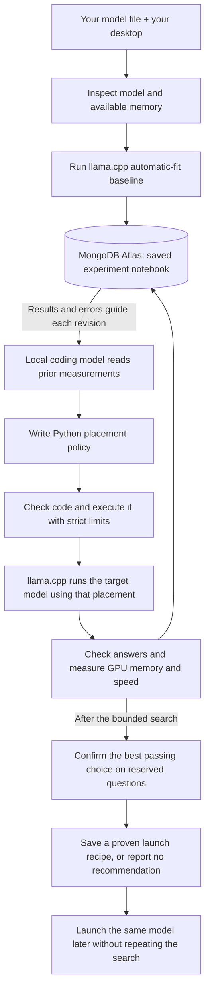

# Atlas GPU Harness

**A 30 GB language model. A 16 GB graphics card. A coding harness that tests how to run it.**

Developers want capable open models on hardware they already own. When model weights exceed GPU memory, CPU offload makes local inference possible—but choosing settings becomes an engineering experiment. Each new model needs a configuration that fits, answers correctly, and responds usefully.

We ran **Kimi-Linear-48B-A3B Q4_K_M, a 30.06 GB file, on a 16 GB RTX 5070 Ti**. llama.cpp's existing automatic CPU/GPU placement passed all 12 tuning checks and four reserved confirmation questions within the card's sampled memory capacity. It remained the selected configuration after two generated policies were tested.

**Our contribution is the coding experiment around that engine:** a local agent writes a Python placement policy, the harness tests it against automatic fitting, and measured answers, memory, speed, and errors become feedback for the next attempt. Atlas preserves the code-to-result history. Reserved questions decide whether to accept the candidate or keep the baseline, and a confirmed choice becomes a reusable launch recipe.

[Visual evidence dashboard](demo-ui/index.html) · [59-second demo video](demo/atlas-inference-demo.mp4) · [Submission text](SUBMISSION.md) · [Measured inference results](INFERENCE_RESULTS.md) · [Deployment engineer](DEPLOYMENT_ENGINEER.md) · [System design](ARCHITECTURE.md) · [Hackathon fit](HACKATHON_REVIEW.md) · [Demo](DEMO.md) · [Original work](NEW_WORK.md)

The visual dashboard uses the design and motion replay from the `ui` branch. Its Kimi chart shows saved inference measurements; the replay below it shows an earlier PyTorch operator experiment. The vLLM, SGLang, and Ollama queue is a planning view, not a live benchmark feed. Serve the repository with `python3 -m http.server 8000` and open `http://127.0.0.1:8000/demo-ui/` to browse the relative evidence links.

## What the framework does

Atlas GPU Harness is an **LLM deployment experiment framework**. It starts with a model artifact, available GPU/RAM/SSD capacity, and a fixed workload; proposes a runtime configuration; records answers, latency, resource use, and failures; and uses those results to choose the next experiment. A proposed setting is a hypothesis, not an optimization claim. The measured MoE loop confirms its final choice on reserved tasks; the newer deployment path reports preliminary benchmark outcomes.

There are two paths with different levels of evidence:

| Path | Implemented workflow | Current evidence |
| --- | --- | --- |
| **MoE placement loop** | A local coding model writes a constrained `n_cpu_moe` policy; llama.cpp runs the same GGUF under automatic fitting and proposed placements; MongoDB Atlas stores trials, failures, decisions, and a resumable recommendation. | Completed Kimi and Qwen trials below. The engine baseline won; no generated speedup is claimed. |
| **Deployment engineer** | Searches first-party vLLM, SGLang, Ollama, and Unsloth documentation indexes; plans source-cited GPU, RAM, SSD, and MoE experiments; benchmarks a running local OpenAI-compatible endpoint; and compares saved JSON outcomes. Unsloth supplies export guidance rather than a serving backend. | Planner and benchmark contract are tested. Live vLLM/SGLang deployment results and Atlas-backed resume for this path are not yet demonstrated. See the [operator guide](DEPLOYMENT_ENGINEER.md). |

**Long horizon means continuity across experiments, not a longer model context window.** The demonstrated placement loop saves measurements in Atlas, retrieves compatible tuning evidence for the next coding attempt, and can resume after interruption without repeating committed trials. Its coding model has a 4,096-token context capacity. The newer deployment path can consume prior benchmark JSON to propose the next configuration, but its results are not yet part of that Atlas resume loop. The measured long-horizon claim therefore rests on the placement loop and remains bounded to a few attempts, not autonomous days of work.

## What is running today?

The consumer inference loop is implemented: model inspection, real local code generation, constrained code execution, baseline and candidate inference, answer checks, memory sampling, feedback, held-out confirmation, Atlas persistence, resume, and reuse of a confirmed recipe.

| Model / experiment | Evidence status |
| --- | --- |
| Kimi-Linear-48B-A3B Q4_K_M, **30.06 GB** | **Completed four trials.** All three tuning trials passed **12/12**; automatic fitting was fastest at **47.21 short-answer decode tokens/s** and **15,472 MiB** sampled peak on the **16,303 MiB GPU**. The selected baseline then passed **4/4 reserved questions**, with **14,664 MiB** sampled peak, and was retained. |
| Qwen3.5-35B-A3B UD-IQ2_M, **11.39 GB file** | **Completed seven trials.** Each of three tuning trials passed **12/12 checks**; each of four confirmation trials passed **4/4**. The engine baseline was retained. Its tuning peak was **12,880 MiB**. |
| Qwen3-30B-A3B Q4_K_M, **18.56 GB** | Download complete and full-file SHA-256 verified; larger-than-card inference proof pending. |

Each tuning trial's 12 checks are **six distinct questions repeated twice**. Kimi's completed run is `70be4572a9824186999857dadeb1237d`; its baseline establishes operability through existing engine offload. The [full Atlas export](evidence/inference/70be4572a9824186999857dadeb1237d.json) includes both generated policies, all four trials, and the recommendation: **“Engine baseline passed held-out validation.”**

**Feedback produced a real code revision, but the engine baseline still won.** Kimi's first policy chose **13 CPU expert layers** and achieved **22.77 tokens/s**, about **52% below baseline**. After receiving those results, the next proposal removed the `- 1` from its placement calculation and chose **14 layers**. It reached **29.77 tokens/s**: **30.73% above the first candidate, yet 36.94% below automatic fitting**. Both passed all 12 checks. Policy 2's sampled peak was **15,890 MiB** and median full request time **1.137 s**, versus policy 1's **15,791 MiB** and **1.405 s**. This is partial recovery from a bad candidate, not an improvement over the engine. Only the fastest passing choice—the baseline—received reserved-question confirmation and became the saved recommendation.

The completed 35B run shows the acceptance rule working: both proposals produced identical code with `n_cpu_moe=0`; confirmation gains of **+3.5647% and +1.9202%** missed the predefined 5% threshold, so the baseline stayed selected. It did not produce a successful revision or confirmed speedup. Its smaller file fits within VRAM, and downloads overlapped some timing measurements. See the [raw Atlas export](evidence/inference/b88ec5bd304443a3add2b2fa767e2450.json), [summary](evidence/inference-summary.json), [verified model manifest](evidence/inference-models.json), and [result ledger](INFERENCE_RESULTS.md).

## How it works

A **mixture-of-experts (MoE)** model contains many specialist parameter groups; only some participate in each token. Keeping more expert weights in system RAM can reduce GPU memory use, with a possible speed cost. llama.cpp implements that execution. The generated policy chooses how many early layers keep their expert weights on the CPU.



There are two different model roles:

- **Coding model:** local Ollama `gemma3:12b` writes `choose(context)`. Its output is actual Python source with a saved hash, hypothesis, and receipt. The proposer is asked to unload after generation.
- **Target model:** a supported local MoE GGUF runs through a pinned llama.cpp engine. Its answers and resource use determine whether the proposal works.

The generated function returns one setting: `n_cpu_moe`, the number of early layers whose expert weights stay on the CPU. It reads model facts, hardware facts, prior trial summaries, its previous code, and failure feedback. Imports, filesystem access, shell commands, loops, and arbitrary function calls are rejected. The fixed answer checks and acceptance rules remain outside the generated code.

The editable surface is **one placement-policy function**. Current adapters accept the `qwen35moe`, `qwen3moe`, and `kimi-linear` GGUF architectures; the result ledger records which artifacts have actually passed inference.

## How do we prove it works?

| Question | Required evidence |
| --- | --- |
| Can the model run usefully here? | Server starts, completes every fixed answer check, remains healthy, and stays within the sampled memory budget. Report actual model size, quantization, host RAM, and GPU. |
| Did the generated policy improve the engine's default? | Compare the **same weights** against llama.cpp automatic fitting, then confirm a candidate on reserved tasks with reversed run order. |
| Did the harness produce a reusable result? | Retain generated code, commands, answers, metrics, failures, and validation IDs; reload the saved recipe with compatibility checks. |

### The baseline is already capable

The reference uses llama.cpp's existing `--gpu-layers auto --fit on` behavior. Every new run measures it first. Candidate policies use `--gpu-layers all --n-cpu-moe N --fit off`. The experiment compares placement strategies while keeping the quantized model file fixed. CPU/GPU offload and automatic fitting are credited to [llama.cpp](https://github.com/ggml-org/llama.cpp/blob/b11429/tools/server/README.md).

The CLI defaults to the card's **physical memory capacity**: 16,303 MiB here. The baseline retains the engine's minimum 1,024 MiB fit margin. An optional lower `--gpu-budget-mib` creates an explicit experiment constraint.

### Experimental design

| Design element | Implemented control |
| --- | --- |
| Hypothesis | A different CPU/GPU expert placement may produce a passing, faster configuration on this model and machine. |
| Treatment | Only the expert-placement setting changes between generated candidates. |
| Fixed conditions | Model and quantization, engine, 4,096-token context capacity, threads, prompts, decoding settings, and answer rules. |
| Tuning data | Six short exact-answer tasks, each run twice in reverse question order. Generated policies see trial summaries. |
| Reserved confirmation data | Four different questions excluded from proposer feedback. Confirm only the best passing tuning choice. A winning generated candidate gets **baseline → candidate → candidate → baseline**; a winning baseline gets one baseline confirmation. |
| Acceptance gate | All answers pass exact JSON type/value checks; server remains healthy; sampled GPU memory stays within budget. |
| Speed measure | Engine-reported decode tokens/second, compared by matching question; full nonstream request latency is also retained. |
| Directional improvement rule | Both confirmation blocks must pass, and each block's median paired decode gain must exceed **5%**. |
| Budget | Default: one baseline plus two code-generation slots. Invalid or interrupted proposals consume a slot. Confirmation may add up to four engine launches. |

If an apparent tuning gain fails confirmation, the harness keeps the baseline when both baseline confirmations pass. If only the candidate passes both confirmations, it can be recommended for feasibility with speedup explicitly unproven. If neither is confirmed, the harness returns no recipe. The recorded error must explain what failed before calling a feasibility result a memory-capacity improvement.

These checks establish **short-task operability on the tested hardware**. GPU memory is sampled every 250 ms, includes other processes, and can miss brief peaks. Short answers make decode rates noisy; the 5% rule is descriptive, not a confidence interval. [The result ledger](INFERENCE_RESULTS.md) retains the measurements and conditions.

## What we add above the inference engine

| Existing work | What we reuse or learn from it | What this project adds |
| --- | --- | --- |
| [llama.cpp](https://github.com/ggml-org/llama.cpp) | GGUF execution, quantized kernels, CPU/GPU offload, automatic fitting, server API. | Generated placement code tested against that capable baseline, with failures, confirmation, and a reusable result. |
| [Strata](https://github.com/Niko1221/Strata) and [Project Maya](https://github.com/mw00/project-maya) | Inspiration for large MoE inference on consumer hardware; these projects already include setup or calibration. | A bounded experiment-and-verification workflow. Neither is integrated as our backend, and their model support or speed results are not ours. |
| [MongoDB Atlas](https://www.mongodb.com/docs/atlas/) | Durable documents and indexed retrieval. | Experiment evidence becomes the next coding attempt's input and the source of truth for resumed work. |
| Existing model and GGUF publishers | Pretrained models and compressed weight artifacts. | Hardware-specific evaluation of unchanged artifacts. Model size reduction belongs to their quantization work. |

The deliverable is **an inspectable chain from generated source → executed placement → measured outcome → accepted recipe**. The engine supplies the ability to run Kimi; our harness supplies the generated candidate, controlled comparison, feedback, and acceptance decision. A faster or more memory-efficient candidate must earn that claim through the experiment. This is the precise comparison with llama.cpp and the basis for evaluating future algorithms.

## How Atlas is used

| Collection | What it remembers | How the workflow uses it |
| --- | --- | --- |
| `runs` | Model and machine context, budget, generated policies, failed proposals, progress, recommendation. | Resume the same experiment and preserve consumed proposal slots. |
| `experiments` | Exact recipe and command, answer outputs and scores, timings, sampled memory, errors, and tuning/confirmation stage. | Reuse committed trials and compare results under the same context. |
| `decisions` | Hypothesis, chosen trial, and IDs of available prior experiments. | Trace the evidence supplied before testing the next policy. |

Atlas is on the execution path: results are committed before moving on, and saved evidence is read before a new proposal. The proposer receives only compatible tuning summaries; reserved confirmation results stay out of its context. A [decision-to-evidence query](queries/decision-evidence.json) joins each decision to the experiments it retrieved. [ARCHITECTURE.md](ARCHITECTURE.md) gives exact identities, limits, and Data Explorer filters.

## What is “long context” here? Which track fits?

**Statement 1 — Recursive Harnessing:** generated placement code can change in response to measurements, within a fixed evaluator and fixed guardrails. Kimi's policy changed from 13 to 14 CPU expert layers after feedback, improving on its first candidate while remaining slower than automatic fitting. Present this as bounded policy evolution; the completed 35B run generated the same policy twice.

**Statement 2 — Long Horizon Engineering:** Atlas carries measured progress into later attempts and resumed runs. The model has a **4,096-token** context capacity; the notebook supplies bounded summaries outside that window. This implements durable experimental memory. Full architectural self-improvement, billion-token reasoning, and days of autonomous work are beyond the current demonstration; track acceptance remains with the organizers.

The supplied guide weights round one as impact 20%, technical demo 35%, creativity 15%, and difficulty 30%. The strongest demo shows the model-size problem, working baseline, generated policy and measured outcome, then Atlas evidence and a saved recipe. Finalists must use the event-provided **Atlas Sandbox**. The project owner has confirmed that this cluster was created through the event invitation; this is user confirmation, not an independent Atlas UI verification. [HACKATHON_REVIEW.md](HACKATHON_REVIEW.md) covers criteria and public hackathon guidance reviewed.

## Run it

The current path targets **Linux/WSL x86-64 with one visible NVIDIA GPU**, sufficient system RAM, a local single-file supported GGUF, and a working NVIDIA driver. The verified desktop is a GeForce RTX 5070 Ti with 16,303 MiB VRAM. The setup script installs pinned llama.cpp **b11429 / `d81235049`**, CUDA 12.8 runtime files, and verifies GPU visibility. It does not download model weights.

```bash
python3 -m venv .venv
.venv/bin/python -m pip install -r requirements-inference.txt
.venv/bin/python scripts/setup_inference_engine.py
```

Use a current Python with `tarfile.data_filter`. Older Linux installations may need `--cxx-dir /path/to/existing/modern/cxx/libraries`; the script reports the requirement and keeps its runtime under `artifacts/engines/`. It does not replace system libraries.

Start a local Ollama service with `gemma3:12b` available at `127.0.0.1:11434`. Put the event Atlas URI in the ignored `.env` file as `MONGODB_URI=...`; `.env.example` has placeholders. Supply the actual path to a downloaded GGUF:

```bash
# Inspect metadata and the machine; this is an estimate, not an inference test.
.venv/bin/python -m atlas_gpu_harness.inference inspect \
  --model /path/to/model.gguf

# Establish the baseline, generate/test two policies, then confirm a choice.
.venv/bin/python -m atlas_gpu_harness.inference evolve \
  --model /path/to/model.gguf \
  --engine artifacts/engines/llama-b11429/launch-llama.sh \
  --budget-evals 3

# Resume the printed run ID with the same model, engine, machine and source.
.venv/bin/python -m atlas_gpu_harness.inference evolve \
  --model /path/to/model.gguf \
  --engine artifacts/engines/llama-b11429/launch-llama.sh \
  --resume-run RUN_ID

# Reuse a confirmed configuration; this does not rerun the search.
.venv/bin/python -m atlas_gpu_harness.inference_serve \
  --recipe artifacts/inference/RUN_ID/recommendation.json \
  --port 8081
```

The Kimi recipe was actually relaunched and answered the same short API check correctly from both WSL and Windows. [Launch receipt](evidence/inference-serve.json) · [Completed-run resume receipt](evidence/inference-resume.json). Its existing llama.cpp interface is at `http://127.0.0.1:8081/` while running.

Keep `recommendation.json` beside `report.json`. The launch helper requires a matching successful confirmation and checks model, engine, hardware, and evaluation compatibility. Once llama.cpp finishes loading, the API is `http://127.0.0.1:8081/v1`. Ctrl+C stops the owned server. Recipe reuse reads local evidence without Atlas or another generation call.

Per-run artifacts include policy `.py` files and receipts, server logs, trial JSON, `report.json`, and `recommendation.json`. If the recommendation's `recipe` is `null`, no configuration met the confirmation rules.

### Code checks without inference

```bash
.venv/bin/python -m pip install -r requirements-dev.txt
.venv/bin/python -m unittest discover -s tests -p 'test_policy_codegen.py' -v
.venv/bin/python -m unittest discover -s tests -p 'test_model_probe.py' -v
.venv/bin/python -m unittest discover -s tests -p 'test_inference*.py' -v
```

These cover generated-code restrictions, metadata, orchestration, measurements, and saved-recipe guards using fixtures. The complete project suite passed **46 tests** at this revision. Real GPU/Atlas runs provide separate integration evidence in [INFERENCE_RESULTS.md](INFERENCE_RESULTS.md).

## Scope and next experiments

Current value is the generated-code experiment and evidenced recipe. No confirmed inference gain over automatic fitting has been demonstrated yet, and code generation has not been compared with a simple parameter sweep. The short task suite does not establish general model quality or long-context performance. Support is limited to the implemented architectures and tested artifacts.

After the validated submission, the same evaluation approach could compare new expert-offload algorithms, pruning, or merging, with appropriate quality baselines. These are future work. The current system keeps weights fixed and generates no CUDA kernels.

## Earlier subsystem evidence

The original PyTorch top-k prototype remains available through `python -m atlas_gpu_harness`. Its [controlled memory comparison](EXPERIMENTS.md) observed **4 → 3 attempts** in two blocks while assessing the same three correct alternatives. Its [recovery demonstration](EVIDENCE.md) retained a committed result across a deliberate interruption. Those results test the original experiment-notebook mechanism; they do not measure LLM memory use, answer quality, or inference acceleration.

See [ATTRIBUTION.md](ATTRIBUTION.md) and [NEW_WORK.md](NEW_WORK.md) for reused foundations and event work.
