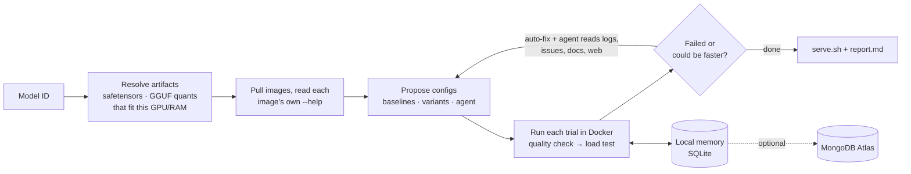

# atlas

**Pick a model. atlas runs it on vLLM, SGLang and llama.cpp on your GPU, tunes each one, and gives you the launch command that it proved is fastest and still answers correctly.**

```bash
uv run atlas run Qwen/Qwen3-30B-A3B
```

Planning that run for a 16 GB GPU (`--dry-run --gpu-gib 16`) shows what atlas will try:

```
  artifact gguf:unsloth/Qwen3-30B-A3B-GGUF:Q2_K  10.49 GiB
  artifact gguf:unsloth/Qwen3-30B-A3B-GGUF:Q4_K_M  17.28 GiB
  skip sglang: no hf artifact fits this machine (pass --hf-repo with an AWQ/FP8 variant, or a smaller model)
  skip vllm: no hf artifact fits this machine (pass --hf-repo with an AWQ/FP8 variant, or a smaller model)

# llamacpp · engine baseline for this artifact (MoE experts partly in RAM)
docker run -d --gpus all … ghcr.io/ggml-org/llama.cpp:server-cuda -hf unsloth/Qwen3-30B-A3B-GGUF:Q4_K_M … --n-cpu-moe 15 …
```

A real run measures every trial, re-measures the finalists, and writes deploy files for the winner (`serve.sh`, `compose.yaml`, `k8s.yaml`) next to a `report.md`.

## Quickstart

You need an NVIDIA GPU, Docker with the [NVIDIA Container Toolkit](https://docs.nvidia.com/datacenter/cloud-native/container-toolkit/latest/install-guide.html), and [uv](https://docs.astral.sh/uv/getting-started/installation/).

```bash
git clone https://github.com/casualcomputer/atlas-gpu-harness atlas && cd atlas
uv sync
cp .env.example .env          # optional: agent LLM, HF token, Atlas
uv run atlas doctor           # ✓/✗ for Docker, GPU, keys, local memory, Atlas
uv run atlas run Qwen/Qwen3-8B --dry-run   # see the plan and docker commands first
uv run atlas run Qwen/Qwen3-8B
```

## How it works



1. **Resolve.** Reads the model from Hugging Face and finds what each engine can load: the safetensors repo for vLLM/SGLang, and common GGUF quants for llama.cpp. By default it keeps GPU-fitting artifacts plus one MoE offload option. `--allow-cpu-offload` also admits a bounded oversized dense HF/GGUF option when RAM and KV headroom permit; these start with one active sequence.
2. **Read the image's own docs.** atlas runs `--help` and `--version` inside each pulled image, with no network. Only tuning flags that exist in that exact version are used, so renamed or removed flags never reach the engine. The agent reads the same help text.
3. **Propose.** Each artifact gets an engine baseline, then known variants (see the table below). With an agent LLM, it also reads the model card, the engine's GitHub issues and the web, and proposes configs with the URLs that motivated them.
4. **Run.** One container at a time. Each trial runs eight exact-answer smoke checks before streaming load tests. At least two must pass to continue; winner eligibility compares against the best configuration. Any extra cases supplied with `--quality-file` must all pass.
5. **Troubleshoot and refine** (`--rounds`, default 3). After each round:
   - an out-of-memory failure gets an automatic fix, no LLM needed: fp8/q8 KV cache, less VRAM claimed, fewer sequences, more MoE layers in RAM
   - every failed trial gets matching GitHub issues attached
   - the agent, if set, sees each failure's redacted log tail, wrong answers and those issues, writes a diagnosis, researches further, and proposes fixes and refinements of the best result.
6. **Confirm.** The top 3 configs are relaunched and re-measured twice more, interleaved, and ranked by the median. On a real server the same config varies about 10% between runs, so a single measurement can't pick a winner. Quality is rechecked on each relaunch. Even a lone finalist must complete every requested confirmation. Disabled or incomplete confirmations produce provisional results without deployment files. If the runner-up is within 5%, the report calls it a tie.
7. **Judge.** A config can win only if every load-test request succeeded and it answered the quality checks about as well as the best config of the same model (within one check), so a config that degrades the model is excluded. `--goal throughput` ranks by total output tokens/s; `--goal latency` by inverse p99 response time at the lowest requested concurrency (higher score is better). `--max-ttft-ms` optionally enforces a TTFT p99 limit at every requested level.
8. **Remember.** Every measured attempt, reuse and confirmation is recorded separately, along with cached image help. Cache identity includes CPU/RAM and GPU identity, model revision, image, configuration, context and workload requirements. Legacy hardware identities remain visible in history but require new measurements before cache reuse. Transient cached failures retry on a new run; `--retry-failed` also retries other cached failures. The agent sees recent attempt history and diagnostic categories before proposing; history from other or legacy hardware is labeled by fingerprint and treated as context, not reusable proof.

**The agent proposes; the measurement decides.** Configs from an LLM or a web page must use the flags in the table below, must exist in the image's `--help`, and can only win by being measured.

## What gets tuned

| Engine | Flags atlas can set (kept only if the pulled image has them) |
| --- | --- |
| vLLM | `--gpu-memory-utilization`, `--max-num-seqs`, `--max-num-batched-tokens`, `--kv-cache-dtype`, `--enable-prefix-caching`, `--block-size`, `--dtype`, `--enforce-eager`, `--max-cudagraph-capture-size`, `--async-scheduling`, `--cpu-offload-gb`, `--kv-offloading-size` |
| SGLang | `--mem-fraction-static`, `--max-running-requests`, `--chunked-prefill-size`, `--max-prefill-tokens`, `--kv-cache-dtype`, `--schedule-policy`, `--schedule-conservativeness`, `--disable-radix-cache`, `--page-size`, `--cuda-graph-max-bs`, `--disable-cuda-graph`, `--dtype`, `--cpu-offload-gb` |
| llama.cpp | `-ngl`, `--n-cpu-moe`, `--cpu-moe`, `-np`, `-fa`, `-ctk`/`-ctv`, `-b`/`-ub`, `-t`/`-tb`, `--kv-unified`, `--kv-offload`, `--cache-reuse` |

Also compared: model artifacts (full precision, AWQ/FP8 repos you add, GGUF quants) and the three engines themselves.

Not tuned yet: speculative decoding (needs a draft model), attention-backend selection, tensor/expert parallelism (single GPU), and environment-variable settings.

## Agent and harness

atlas uses **one optional LLM agent**, not a multiagent team. Research, planning and diagnosis happen in that same agent; execution, scoring and storage are ordinary Python modules. It has two halves:
- **The harness** decides what is true. It runs containers one at a time, checks answers, load-tests, re-measures, and keeps the record. It works with no LLM at all.
- **The agent** (optional) only proposes. It reads the image help, docs, issues and the web, and suggests configs and fixes. It can't run anything, and its ideas count only after the harness has measured them.

## Deploy files

For a confirmed winner, atlas writes three files. They pin the measured image digest and resolved model revision, use the same arguments and context length, and require an API key:

| File | Use |
| --- | --- |
| `serve.sh` | `export API_KEY=…; ./serve.sh` on the machine that was tuned |
| `compose.yaml` | `API_KEY=… docker compose up -d` |
| `k8s.yaml` | Deployment + Service with GPU limit, startup/readiness/liveness probes on `/health`, API key from a Secret, model cache on a PVC |

## Corporate networks and CPU testing

| Variable | Effect |
| --- | --- |
| `HTTPS_PROXY`, `HTTP_PROXY`, `NO_PROXY` | passed into engine containers by name, so weights download through your proxy |
| `ATLAS_CA_BUNDLE=/path/ca.pem` | mounted read-only into containers and trusted for TLS (TLS-inspecting proxies) |
| `ATLAS_DOCKER_NETWORK=host` | host networking, needed when the proxy listens on 127.0.0.1 |
| `ATLAS_GPUS=none` | run CPU images (e.g. `ATLAS_LLAMACPP_IMAGE=ghcr.io/ggml-org/llama.cpp:server`) for pipeline tests |
| `ATLAS_<ENGINE>_IMAGE` | pin an image or use an internal registry mirror |

## Commands

| Command | |
| --- | --- |
| `atlas doctor` | Check Docker, NVIDIA runtime, GPU, keys, local memory and Atlas, with a fix for each failure |
| `atlas run MODEL` | Benchmark every engine and keep the best. Options: `--context 8192` (what you'll serve), `--goal throughput\|latency`, `--workload smoke\|chat\|rag\|batch`, `--engines vllm,llamacpp`, `--budget-minutes 90`, `--max-trials 5` (per engine per round), `--rounds 3`, `--confirm 2`, `--llm …`, `--no-research`, `--no-share-logs` |
| `atlas run MODEL --dry-run [--gpu-gib 24]` | Show the artifacts, trials and docker commands without starting anything, optionally for another GPU size |
| `atlas run MODEL --hf-repo org/MODEL-AWQ` | Also try a quantized safetensors repo with vLLM/SGLang (for models whose full weights don't fit) |
| `atlas history [MODEL] [--details] [--run-id ID] [--json]` | Past runs and immutable attempts, explanations and measurements |
| `atlas recipe MODEL` | The best verified launch command on this machine |
| `atlas sync` | Copy local memory to MongoDB Atlas |

Workloads: `smoke` (64 in / 32 out, 1–2 concurrent; checks a setup in minutes), `chat` (256 / 256, 1–16), `rag` (4,000 / 256, 1–4), `batch` (512 / 512, 16–64).

## Offloading, retries and your workload

```bash
uv run atlas run Qwen/Qwen3-8B --allow-cpu-offload
uv run atlas run Qwen/Qwen3-8B --retry-failed
uv run atlas history Qwen/Qwen3-8B --details
uv run atlas history --run-id RUN_ID --json
uv run atlas run Qwen/Qwen3-8B --concurrency 1,4 --max-ttft-ms 1000 --quality-file checks.json
```

`checks.json` is a list of additional exact-answer checks. Without `system`, the prompt is sent as a user-only message. For example:

```json
[
  {"name": "arithmetic", "prompt": "What is 37 + 58? Return only the integer answer.", "expected": 95},
  {"name": "extract", "system": "Return only the city.", "prompt": "City: Oslo", "expected": "Oslo"}
]
```

These checks supplement the built-in suite and must all pass in both trials and confirmations. Load prompts remain synthetic; this does not implement production-traffic replay. New requirements change the cache key. `--confirm 0` intentionally produces provisional measurements only.

Offload amounts are conservative estimates, then measured on the hardware. CPU execution and transfers can be much slower. Missing required offload flags cause the candidate to be skipped rather than silently launching an all-GPU configuration. HF models use `--revision`; GGUFs use an immutable download URL and a persistent revision-specific cache filename. An old unpinned GGUF cache may require a one-time download into the new path.

## Keys: none required

`atlas run` works with no accounts or API keys. Hugging Face and GitHub are used anonymously.

| Feature | Needs | Without it |
| --- | --- | --- |
| Model lookup, downloads | nothing (`HF_TOKEN` only for gated models like Llama) | — |
| **Failed trial → matching GitHub issues** in the report | nothing (`GITHUB_TOKEN` raises the rate limit) | — |
| Agent that reads the model card and issues, then proposes extra configs | the LLM key you already have: `ATLAS_LLM` | stock configs only |
| Agent web search | nothing extra: uses your LLM provider's built-in search (Claude, Gemini, OpenAI, xAI, Perplexity) | model card + GitHub only (e.g. local Ollama) |
| Share results across machines | MongoDB Atlas: `MONGODB_URI` + `uv sync --extra atlas` | local SQLite only |

`ATLAS_LLM` is any [LiteLLM](https://docs.litellm.ai/docs/providers) model string: `anthropic/claude-sonnet-5-5`, `gemini/gemini-2.5-flash`, `ollama_chat/qwen3:8b`, or `openai/<model>` with `OPENAI_API_BASE` for any OpenAI-compatible server. `atlas doctor` shows whether your model has built-in search.

What the agent reads, and how:

| Source | How | Key |
| --- | --- | --- |
| The engine image's own `--help` | run inside the image, cached per digest | none |
| Official engine docs, model cards, any public page | `fetch_page`, `model_card` | none |
| vLLM, SGLang and llama.cpp GitHub issues | GitHub search API | none (`GITHUB_TOKEN` raises the limit) |
| Reddit, forums, blogs | the LLM provider's built-in web search | your LLM key |

We tested these on real models. Model cards for Qwen3 and gpt-oss carry exact vLLM and SGLang serve commands. Anonymous GitHub issue search returns relevant bugs for a real error (for example vLLM out-of-memory with fp8 KV cache). Reddit blocks anonymous API access, so Reddit threads reach the agent only through its provider's web search. A local model without web search still gets the image help, docs, model cards and GitHub.

## Isolation

The agent can only read the cached image help, search GitHub issues, read public web pages and model cards, and submit configs. It has no tool for local files, commands or Docker, and its configs pass an allowlist of tuning flags. Engine containers see only the GPU and the two model caches. [SECURITY.md](SECURITY.md) lists what leaves the machine and what is not yet enterprise-ready.

A local Ollama model shares your GPU. Its memory shows up in the results, so stop it or use a hosted model for clean numbers.

## Memory

Local memory is a SQLite file at `~/.atlas-tune/atlas.db` (change it with `ATLAS_HOME`). It holds runs, a reusable configuration cache, append-only attempts (config, hypothesis, sources, source commit, workload version, model revision, quality answers, latency/throughput per level, GPU peak and failures), and confirmed recipes. Confirmations retain their full measurements. Existing databases import their last known cached rows once as `legacy`; overwritten historical attempts cannot be reconstructed.

Set `MONGODB_URI` and install the extra (`uv sync --extra atlas`), and the same records are mirrored to MongoDB Atlas (`tune_runs`, `tune_trials`, `tune_attempts`, `tune_recipes`), so a team or several machines share verified results. `atlas sync` backfills Atlas from local memory.

Failure descriptions distinguish memory reservations, allocator/KV OOMs, disk exhaustion, occupied ports, authentication, unsupported settings/hardware, timeouts, network/TLS failures, quality failures, load failures and latency-limit breaches. Unknown failures stay unknown. These are evidence-based hints, not proof of the root cause; the optional LLM can research logs and propose a more specific diagnosis.

## What has been tested, and known limits

**Tested for real** (in a CPU-only Linux sandbox with Docker):
- the real llama.cpp server image, end to end: image pull, `--help` parsing (all 14 flags present), model download inside the container through a TLS-inspecting proxy, trials, quality checks, load tests, confirmation, deploy
- the generated `serve.sh`: 401 without a key, correct answers with it, pinned digest, restart policy
- the generated `compose.yaml`: passes `docker compose config`
- vLLM 0.31.0's real `serve --help`: all 12 vLLM flags present, help search works
- SGLang's current source: flags checked, including one renamed on its main branch, which atlas now maps

Testing also found and fixed:
- a benchmark-client bug that failed ~10% of requests against llama.cpp
- answers marked wrong for formatting
- recipes served at the test context instead of the production one
- a 25+ GB image filling the disk mid-pull
- old results being reused after the scoring changed

**RTX 5070 Ti validation:** llama.cpp, vLLM and SGLang completed real GPU runs, including finalist confirmations and generated serving checks. A real vLLM startup memory refusal recovered through the deterministic fix loop. See [GPU_TEST_RESULTS.md](GPU_TEST_RESULTS.md) for exact versions, measurements and limitations. No agent provider was configured, so live LLM-driven research/recovery remains unverified; its tool flow is covered with a fake provider.

**Known limits:**
- One host, one GPU, one engine at a time. No tensor/expert parallelism, multi-node or fleet runs.
- The workload is synthetic. Output lengths vary by model, so compare tokens/s rather than request times; replaying your own traffic is not supported yet.
- Quality is an 8-question smoke test relative to the model's best config. It catches broken templates and quantization damage, not subtle accuracy loss; run your own eval on the winner.
- Ranking is throughput or inverse p99 response time at the lowest concurrency. An optional TTFT p99 ceiling gates every level; this is not a full production SLO evaluator.
- Not tuned: speculative decoding, attention backend, environment-variable settings, TensorRT-LLM, TGI.
- vLLM/SGLang CPU offloading is opt-in and image-dependent; its new automatic planning has unit coverage but still needs live validation. Quantized `--hf-repo` remains available; automatic AWQ/FP8 discovery is not implemented.
- `k8s.yaml` has passed YAML checks but has not been applied to a cluster. It assumes a `model-cache` PVC and NVIDIA's device plugin.
- Security: see [SECURITY.md](SECURITY.md). It's a single-user CLI with no SSO, RBAC or audit log.

## Development

```bash
uv run python -m unittest discover -s tests -v
```

The tests run the full loop against a fake OpenAI-compatible engine, so they need no Docker, GPU or network.
