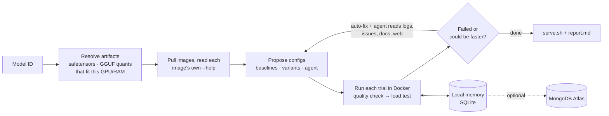

# atlas

**Pick a model. atlas runs it on vLLM, SGLang and llama.cpp on your GPU, tunes each one, and gives you the launch command that it proved is fastest and still answers correctly.**

```bash
uv run atlas run Qwen/Qwen3-30B-A3B
```

Planning that run for a 16 GB GPU (`--dry-run --gpu-gib 16`) shows what atlas will try:

```
  artifact gguf:unsloth/Qwen3-30B-A3B-GGUF:Q2_K  10.49 GiB
  artifact gguf:unsloth/Qwen3-30B-A3B-GGUF:Q4_K_M  17.28 GiB
  skip sglang: no hf artifact fits this machine (pass --hf-repo with an AWQ/FP8 variant, or a smaller model)
  skip vllm: no hf artifact fits this machine (pass --hf-repo with an AWQ/FP8 variant, or a smaller model)

# llamacpp · engine baseline for this artifact (MoE experts partly in RAM)
docker run -d --gpus all … ghcr.io/ggml-org/llama.cpp:server-cuda -hf unsloth/Qwen3-30B-A3B-GGUF:Q4_K_M … --n-cpu-moe 15 …
```

A real run then measures every trial and ends with the winning `docker run` command, a `serve.sh` and a `report.md`.

## Quickstart

You need an NVIDIA GPU, Docker with the [NVIDIA Container Toolkit](https://docs.nvidia.com/datacenter/cloud-native/container-toolkit/latest/install-guide.html), and [uv](https://docs.astral.sh/uv/getting-started/installation/).

```bash
git clone https://github.com/casualcomputer/atlas-gpu-harness atlas && cd atlas
uv sync
cp .env.example .env          # optional: agent LLM, HF token, Atlas
uv run atlas doctor           # ✓/✗ for Docker, GPU, keys, local memory, Atlas
uv run atlas run Qwen/Qwen3-8B --dry-run   # see the plan and docker commands first
uv run atlas run Qwen/Qwen3-8B
```

## How it works



1. **Resolve.** Reads the model from Hugging Face and finds what each engine can load: the safetensors repo for vLLM/SGLang, and common GGUF quants for llama.cpp. Only artifacts that fit your GPU are kept, plus one MoE quant that fits with experts offloaded to RAM.
2. **Read the image's own docs.** atlas runs `--help` and `--version` inside each pulled image, with no network. Only tuning flags that exist in that exact version are used, so renamed or removed flags never reach the engine. The agent reads the same help text.
3. **Propose.** Each artifact gets an engine baseline, then known variants (see the table below). With an agent LLM, it also reads the model card, the engine's GitHub issues and the web, and proposes configs with the URLs that motivated them.
4. **Run.** One container at a time. Each trial must answer 8 exact-answer questions correctly before it is load-tested with streaming requests at several concurrency levels.
5. **Troubleshoot and refine** (`--rounds`, default 3). After each round:
   - an out-of-memory failure gets an automatic fix, no LLM needed: fp8/q8 KV cache, less VRAM claimed, fewer sequences, more MoE layers in RAM
   - every failed trial gets matching GitHub issues attached
   - the agent, if set, sees each failure's redacted log tail, wrong answers and those issues, writes a diagnosis, researches further, and proposes fixes and refinements of the best result.
6. **Judge.** Only correct trials where every request succeeded can win. `--goal throughput` ranks by total output tokens/s; `--goal latency` by single-user decode speed.
7. **Remember.** Every trial and every image's help text is stored locally. Re-running skips anything already measured on this machine, image digest and config, and the agent sees past results before proposing.

**The agent proposes; the measurement decides.** Configs from an LLM or a web page must use the flags in the table below, must exist in the image's `--help`, and can only win by being measured.

## What gets tuned

| Engine | Flags atlas can set (kept only if the pulled image has them) |
| --- | --- |
| vLLM | `--gpu-memory-utilization`, `--max-num-seqs`, `--max-num-batched-tokens`, `--kv-cache-dtype`, `--enable-prefix-caching`, `--block-size`, `--dtype`, `--enforce-eager`, `--max-cudagraph-capture-size`, `--async-scheduling`, `--cpu-offload-gb`, `--kv-offloading-size` |
| SGLang | `--mem-fraction-static`, `--max-running-requests`, `--chunked-prefill-size`, `--max-prefill-tokens`, `--kv-cache-dtype`, `--schedule-policy`, `--schedule-conservativeness`, `--disable-radix-cache`, `--page-size`, `--cuda-graph-max-bs`, `--disable-cuda-graph`, `--dtype`, `--cpu-offload-gb` |
| llama.cpp | `-ngl`, `--n-cpu-moe`, `--cpu-moe`, `-np`, `-fa`, `-ctk`/`-ctv`, `-b`/`-ub`, `-t`/`-tb`, `--kv-unified`, `--kv-offload`, `--cache-reuse` |

Also compared: model artifacts (full precision, AWQ/FP8 repos you add, GGUF quants) and the three engines themselves.

Not tuned yet: speculative decoding (needs a draft model), attention-backend selection, tensor/expert parallelism (single GPU), and environment-variable settings.

## Commands

| Command | |
| --- | --- |
| `atlas doctor` | Check Docker, NVIDIA runtime, GPU, keys, local memory and Atlas, with a fix for each failure |
| `atlas run MODEL` | Benchmark every engine and keep the best. Options: `--goal throughput\|latency`, `--workload chat\|rag\|batch`, `--engines vllm,llamacpp`, `--budget-minutes 90`, `--max-trials 5` (per engine per round), `--rounds 3`, `--llm …`, `--no-research`, `--no-share-logs` |
| `atlas run MODEL --dry-run [--gpu-gib 24]` | Show the artifacts, trials and docker commands without starting anything, optionally for another GPU size |
| `atlas run MODEL --hf-repo org/MODEL-AWQ` | Also try a quantized safetensors repo with vLLM/SGLang (for models whose full weights don't fit) |
| `atlas history [MODEL]` | Past runs and trials from local memory |
| `atlas recipe MODEL` | The best verified launch command on this machine |
| `atlas sync` | Copy local memory to MongoDB Atlas |

Workloads: `chat` (256 in / 256 out, 1–16 concurrent), `rag` (4,000 in / 256 out, 1–4 concurrent), `batch` (512 / 512, 16–64 concurrent).

## Keys: none required

`atlas run` works with no accounts or API keys. Hugging Face and GitHub are used anonymously.

| Feature | Needs | Without it |
| --- | --- | --- |
| Model lookup, downloads | nothing (`HF_TOKEN` only for gated models like Llama) | — |
| **Failed trial → matching GitHub issues** in the report | nothing (`GITHUB_TOKEN` raises the rate limit) | — |
| Agent that reads the model card and issues, then proposes extra configs | the LLM key you already have: `ATLAS_LLM` | stock configs only |
| Agent web search | nothing extra: uses your LLM provider's built-in search (Claude, Gemini, OpenAI, xAI, Perplexity) | model card + GitHub only (e.g. local Ollama) |
| Share results across machines | MongoDB Atlas: `MONGODB_URI` + `uv sync --extra atlas` | local SQLite only |

`ATLAS_LLM` is any [LiteLLM](https://docs.litellm.ai/docs/providers) model string: `anthropic/claude-sonnet-5-5`, `gemini/gemini-2.5-flash`, `ollama_chat/qwen3:8b`, or `openai/<model>` with `OPENAI_API_BASE` for any OpenAI-compatible server. `atlas doctor` shows whether your model has built-in search.

What the agent reads, and how:

| Source | How | Key |
| --- | --- | --- |
| The engine image's own `--help` | run inside the image, cached per digest | none |
| Official engine docs, model cards, any public page | `fetch_page`, `model_card` | none |
| vLLM, SGLang and llama.cpp GitHub issues | GitHub search API | none (`GITHUB_TOKEN` raises the limit) |
| Reddit, forums, blogs | the LLM provider's built-in web search | your LLM key |

We tested these on real models. Model cards for Qwen3 and gpt-oss carry exact vLLM and SGLang serve commands. Anonymous GitHub issue search returns relevant bugs for a real error (for example vLLM out-of-memory with fp8 KV cache). Reddit blocks anonymous API access, so Reddit threads reach the agent only through its provider's web search. A local model without web search still gets the image help, docs, model cards and GitHub.

## Isolation

The agent can only read the cached image help, search GitHub issues, read public web pages and model cards, and submit configs. It has no tool for local files, commands or Docker, and its configs pass an allowlist of tuning flags. Engine containers see only the GPU and the two model caches. [SECURITY.md](SECURITY.md) lists what leaves the machine and what is not yet enterprise-ready.

A local Ollama model shares your GPU. Its memory shows up in the results, so stop it or use a hosted model for clean numbers.

## Memory

Local memory is a SQLite file at `~/.atlas-tune/atlas.db` (change it with `ATLAS_HOME`). It holds runs, every trial (config, quality answers, latency and throughput per concurrency level, sampled GPU memory, errors and log tail, sources) and the best recipe per model, machine, engine and goal.

Set `MONGODB_URI` and install the extra (`uv sync --extra atlas`), and the same records are mirrored to MongoDB Atlas (`tune_runs`, `tune_trials`, `tune_recipes`), so a team or several machines share verified results. `atlas sync` backfills Atlas from local memory.

## Limits

- One NVIDIA GPU per run; engines run one at a time.
- The quality check is an 8-question smoke test that catches broken templates or quantization. It is not a full evaluation.
- The load test uses synthetic prompts. Output length varies with the model, and GPU memory is sampled for the whole device.
- vLLM and SGLang need weights that fit in VRAM. For larger models pass a quantized `--hf-repo`; llama.cpp handles MoE offload to RAM.
- Images default to `:latest`. Each trial records the exact image digest, and you can pin with `ATLAS_VLLM_IMAGE` and friends.

## Development

```bash
uv run python -m unittest discover -s tests -v
```

The tests run the full loop against a fake OpenAI-compatible engine, so they need no Docker, GPU or network.
