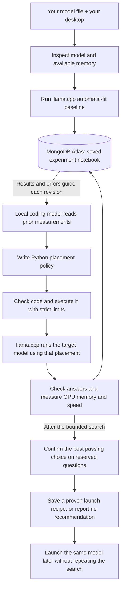

# Atlas GPU Harness

**An agent writes and tests the code that decides how a large language model shares a consumer GPU and system RAM.**

You have a 16 GB graphics card and want to run a capable open model locally. Its weights can exceed the entire card before there is room for conversation memory. Existing inference engines can share work with the CPU, but every new model brings another round of setup, memory failures, and speed tradeoffs. *Did this setting actually work? Is it better than the engine's default? Can I use it again tomorrow?*

Atlas GPU Harness turns that work into a measured loop. A local coding model writes a small Python placement policy. The harness checks the code, runs the target model through llama.cpp, checks its answers, measures memory and speed, and returns the results for revision. MongoDB Atlas keeps the experiment notebook. A configuration that passes confirmation becomes a saved launch recipe.

The immediate benefit is **a repeatable route from a supported model file to an evidenced configuration on this machine**. Faster inference is an experimental outcome to establish, not a promise attached to every generated policy.

[Measured inference results](INFERENCE_RESULTS.md) · [System design](ARCHITECTURE.md) · [Hackathon fit](HACKATHON_REVIEW.md) · [Demo](DEMO.md) · [Original work](NEW_WORK.md)

## What is running today?

The consumer inference loop is implemented: model inspection, real local code generation, constrained code execution, baseline and candidate inference, answer checks, memory sampling, feedback, held-out confirmation, Atlas persistence, resume, and reuse of a confirmed recipe.

| Model / experiment | Evidence status |
| --- | --- |
| Qwen3.5-35B-A3B UD-IQ2_M, **11.39 GB file** | **Completed seven trials.** Each of three tuning trials passed **12/12 checks**; each of four confirmation trials passed **4/4**. The engine baseline was retained. Its tuning peak was **12,880 MiB** on the **16,303 MiB RTX 5070 Ti**. |
| Qwen3-30B-A3B Q4_K_M, **18.56 GB** | Download complete and full-file SHA-256 verified; larger-than-card inference proof pending. |
| Kimi-Linear-48B-A3B Q4_K_M, **30.06 GB** | Download complete and full-file SHA-256 verified; real inference run underway, outcome pending. |

**The completed 35B run did not establish an improvement.** Both code-generation attempts produced identical source and chose `n_cpu_moe=0`. The candidate's paired confirmation gains were **+3.5647% and +1.9202%**, both below the predefined 5% threshold, so the harness retained automatic fitting. This demonstrates real generation, execution, feedback, and rejection of an unconfirmed gain; this run did not demonstrate a successful code revision. See the [raw Atlas export](evidence/inference/b88ec5bd304443a3add2b2fa767e2450.json) and [machine-readable summary](evidence/inference-summary.json).

The 35B model's compressed file fits within the card's capacity, so it does **not** establish offloading a file larger than VRAM. Concurrent downloads also confound early speed measurements. The [model manifest](evidence/inference-models.json) records verified sizes, revisions, and full checksums for the two larger downloads. [INFERENCE_RESULTS.md](INFERENCE_RESULTS.md) is the result ledger, including failures and completed confirmations. No general speedup or arbitrary-model compatibility is claimed.

## How it works

A **mixture-of-experts (MoE)** model contains many specialist parameter groups; only some participate in each token. Keeping more expert weights in system RAM can reduce GPU memory use, with a possible speed cost. llama.cpp implements that execution. The generated policy chooses how many early layers keep their expert weights on the CPU.



There are two different model roles:

- **Coding model:** local Ollama `gemma3:12b` writes `choose(context)`. Its output is actual Python source with a saved hash, hypothesis, and receipt. The proposer is asked to unload after generation.
- **Target model:** a supported local MoE GGUF runs through a pinned llama.cpp engine. Its answers and resource use determine whether the proposal works.

The generated function returns one setting: `n_cpu_moe`, the number of early layers whose expert weights stay on the CPU. It reads model facts, hardware facts, prior trial summaries, its previous code, and failure feedback. Imports, filesystem access, shell commands, loops, and arbitrary function calls are rejected. The fixed answer checks and acceptance rules remain outside the generated code.

**This is a coding harness for placement policies.** It does not generate CUDA kernels, change neural-network weights, invent quantization, or modify the evaluator. Current adapters accept the `qwen35moe`, `qwen3moe`, and `kimi-linear` GGUF architectures; accepting metadata is distinct from passing a real inference run.

## How do we prove it works?

| Question | Required evidence |
| --- | --- |
| Can the model run usefully here? | Server starts, completes every fixed answer check, remains healthy, and stays within the sampled memory budget. Report actual model size, quantization, host RAM, and GPU. |
| Did the generated policy improve the engine's default? | Compare the **same weights** against llama.cpp automatic fitting, then confirm a candidate on reserved tasks with reversed run order. |
| Did the harness produce a reusable result? | Retain generated code, commands, answers, metrics, failures, and validation IDs; reload the saved recipe with compatibility checks. |

### The baseline is already capable

The reference uses llama.cpp's existing `--gpu-layers auto --fit on` behavior. Every new run measures it first. Candidate policies use `--gpu-layers all --n-cpu-moe N --fit off`. The experiment compares placement strategies while keeping the quantized model file fixed. CPU/GPU offload and automatic fitting are credited to [llama.cpp](https://github.com/ggml-org/llama.cpp/blob/b11429/tools/server/README.md).

The CLI defaults to the card's **physical memory capacity**: 16,303 MiB here. There is no artificial 10 GB ceiling in the default workflow. The engine baseline retains its minimum 1,024 MiB fit margin. An optional lower `--gpu-budget-mib` is an explicitly chosen experiment constraint.

### Experimental design

| Design element | Implemented control |
| --- | --- |
| Hypothesis | A different CPU/GPU expert placement may produce a passing, faster configuration on this model and machine. |
| Treatment | Only the expert-placement setting changes between generated candidates. |
| Fixed conditions | Model and quantization, engine, 4,096-token context capacity, threads, prompts, decoding settings, and answer rules. |
| Tuning data | Six short exact-answer tasks, each run twice in reverse question order. Generated policies see trial summaries. |
| Reserved confirmation data | Four different questions excluded from proposer feedback. If a candidate wins tuning, run **baseline → candidate → candidate → baseline**, with a fresh server each time. |
| Acceptance gate | All answers pass exact JSON type/value checks; server remains healthy; sampled GPU memory stays within budget. |
| Speed measure | Engine-reported decode tokens/second, compared by matching question; full nonstream request latency is also retained. |
| Directional improvement rule | Both confirmation blocks must pass, and each block's median paired decode gain must exceed **5%**. |
| Budget | Default: one baseline plus two code-generation slots. Invalid or interrupted proposals consume a slot. Confirmation may add up to four engine launches. |

If an apparent tuning gain fails confirmation, the harness keeps the baseline when both baseline confirmations pass. If only the candidate passes both confirmations, it can be recommended for feasibility with speedup explicitly unproven. If neither is confirmed, the harness returns no recipe. The recorded error must explain what failed before calling a feasibility result a memory-capacity improvement.

These checks establish **short-task operability on the tested hardware**. They do not establish general reasoning quality, long-context quality, production throughput, or a statistical confidence interval. GPU memory is sampled every 250 ms, includes other GPU processes, and can miss brief peaks. Short answers make decode rates noisy. [The result ledger](INFERENCE_RESULTS.md) reports those limits alongside the measurements.

## Why a harness when inference engines already exist?

| Existing work | What we reuse or learn from it | What this project adds |
| --- | --- | --- |
| [llama.cpp](https://github.com/ggml-org/llama.cpp) | GGUF execution, quantized kernels, CPU/GPU offload, automatic fitting, server API. | Generated placement code tested against that capable baseline, with failures, confirmation, and a reusable result. |
| [Strata](https://github.com/Niko1221/Strata) and [Project Maya](https://github.com/mw00/project-maya) | Inspiration for large MoE inference on consumer hardware; these projects already include setup or calibration. | A bounded experiment-and-verification workflow. Neither is integrated as our backend, and their model support or speed results are not ours. |
| [MongoDB Atlas](https://www.mongodb.com/docs/atlas/) | Durable documents and indexed retrieval. | Experiment evidence becomes the next coding attempt's input and the source of truth for resumed work. |
| Existing model and GGUF publishers | Pretrained models and compressed weight artifacts. | Hardware-specific evaluation of unchanged artifacts. Model size reduction belongs to their quantization work. |

The useful distinction is **an inspectable chain from generated source → executed placement → measured outcome → accepted recipe**. Compatible tuning evidence feeds the next code revision. The workflow tests whether a proposed configuration deserves to replace the engine's default. We have not yet measured the incremental benefit of code generation over a simple parameter sweep.

## How Atlas is used

| Collection | What it remembers | How the workflow uses it |
| --- | --- | --- |
| `runs` | Model and machine context, budget, generated policies, failed proposals, progress, recommendation. | Resume the same experiment and preserve consumed proposal slots. |
| `experiments` | Exact recipe and command, answer outputs and scores, timings, sampled memory, errors, and tuning/confirmation stage. | Reuse committed trials and compare results under the same context. |
| `decisions` | Hypothesis, chosen trial, and IDs of available prior experiments. | Trace the evidence supplied before testing the next policy. |

Atlas is on the execution path: results are committed before moving on, and saved evidence is read before a new proposal. The proposer receives only compatible tuning summaries; reserved confirmation results stay out of its context. GPU computation stays on the desktop. [ARCHITECTURE.md](ARCHITECTURE.md) gives exact identities, limits, and Data Explorer filters.

## What is “long context” here? Which track fits?

**Statement 2 — Long Horizon Engineering is the closest fit:** the harness preserves measured progress and carries evidence into later coding attempts and resumed runs. The target model currently has a **4,096-token** context capacity. The notebook lives outside that context and supplies bounded summaries; it does not demonstrate a billion-token conversation or days of autonomous work.

There is a real code-revision loop, but its editable surface is one placement function. The evaluator, tools, guardrails, and overall architecture remain fixed. That is a limited connection to **Statement 1 — Recursive Harnessing**, whose broader self-evolving architecture is not demonstrated. Track acceptance remains with the organizers.

The supplied guide weights round one as impact 20%, technical demo 35%, creativity 15%, and difficulty 30%. The strongest demo shows the model-size problem, working baseline, generated policy and measured outcome, then Atlas evidence and a saved recipe. Finalists must use the event-provided **Atlas Sandbox**. The project owner has confirmed that this cluster was created through the event invitation; this is user confirmation, not an independent Atlas UI verification. [HACKATHON_REVIEW.md](HACKATHON_REVIEW.md) covers criteria and public hackathon guidance reviewed.

## Run it

The current path targets **Linux/WSL x86-64 with one visible NVIDIA GPU**, sufficient system RAM, a local single-file supported GGUF, and a working NVIDIA driver. The verified desktop is a GeForce RTX 5070 Ti with 16,303 MiB VRAM. The setup script installs pinned llama.cpp **b11429 / `d81235049`**, CUDA 12.8 runtime files, and verifies GPU visibility. It does not download model weights.

```bash
python3 -m venv .venv
.venv/bin/python -m pip install -r requirements-inference.txt
.venv/bin/python scripts/setup_inference_engine.py
```

Use a current Python with `tarfile.data_filter`. Older Linux installations may need `--cxx-dir /path/to/existing/modern/cxx/libraries`; the script reports the requirement and keeps its runtime under `artifacts/engines/`. It does not replace system libraries.

Start a local Ollama service with `gemma3:12b` available at `127.0.0.1:11434`. Put the event Atlas URI in the ignored `.env` file as `MONGODB_URI=...`; `.env.example` has placeholders. Supply the actual path to a downloaded GGUF:

```bash
# Inspect metadata and the machine; this is an estimate, not an inference test.
.venv/bin/python -m atlas_gpu_harness.inference inspect \
  --model /path/to/model.gguf

# Establish the baseline, generate/test two policies, then confirm a choice.
.venv/bin/python -m atlas_gpu_harness.inference evolve \
  --model /path/to/model.gguf \
  --engine artifacts/engines/llama-b11429/launch-llama.sh \
  --budget-evals 3

# Resume the printed run ID with the same model, engine, machine and source.
.venv/bin/python -m atlas_gpu_harness.inference evolve \
  --model /path/to/model.gguf \
  --engine artifacts/engines/llama-b11429/launch-llama.sh \
  --resume-run RUN_ID

# Reuse a confirmed configuration; this does not rerun the search.
.venv/bin/python -m atlas_gpu_harness.inference_serve \
  --recipe artifacts/inference/RUN_ID/recommendation.json \
  --port 8081
```

Keep `recommendation.json` beside `report.json`. The launch helper requires a matching successful confirmation and checks model, engine, hardware, and evaluation compatibility. Once llama.cpp finishes loading, the API is `http://127.0.0.1:8081/v1`. Ctrl+C stops the owned server. Recipe reuse reads local evidence without Atlas or another generation call.

Per-run artifacts include policy `.py` files and receipts, server logs, trial JSON, `report.json`, and `recommendation.json`. If the recommendation's `recipe` is `null`, no configuration met the confirmation rules.

### Code checks without inference

```bash
.venv/bin/python -m pip install -r requirements-dev.txt
.venv/bin/python -m unittest discover -s tests -p 'test_policy_codegen.py' -v
.venv/bin/python -m unittest discover -s tests -p 'test_model_probe.py' -v
.venv/bin/python -m unittest discover -s tests -p 'test_inference*.py' -v
```

These cover generated-code restrictions, metadata, orchestration, measurements, and saved-recipe guards using fixtures. The complete project suite passed **46 tests** at this revision. Real GPU/Atlas runs provide separate integration evidence in [INFERENCE_RESULTS.md](INFERENCE_RESULTS.md).

## Earlier subsystem evidence

The original PyTorch top-k prototype remains available through `python -m atlas_gpu_harness`. Its [controlled memory comparison](EXPERIMENTS.md) observed **4 → 3 attempts** in two blocks while assessing the same three correct alternatives. Its [recovery demonstration](EVIDENCE.md) retained a committed result across a deliberate interruption. Those results test the original experiment-notebook mechanism; they do not measure LLM memory use, answer quality, or inference acceleration.

See [ATTRIBUTION.md](ATTRIBUTION.md) and [NEW_WORK.md](NEW_WORK.md) for reused foundations and event work.
