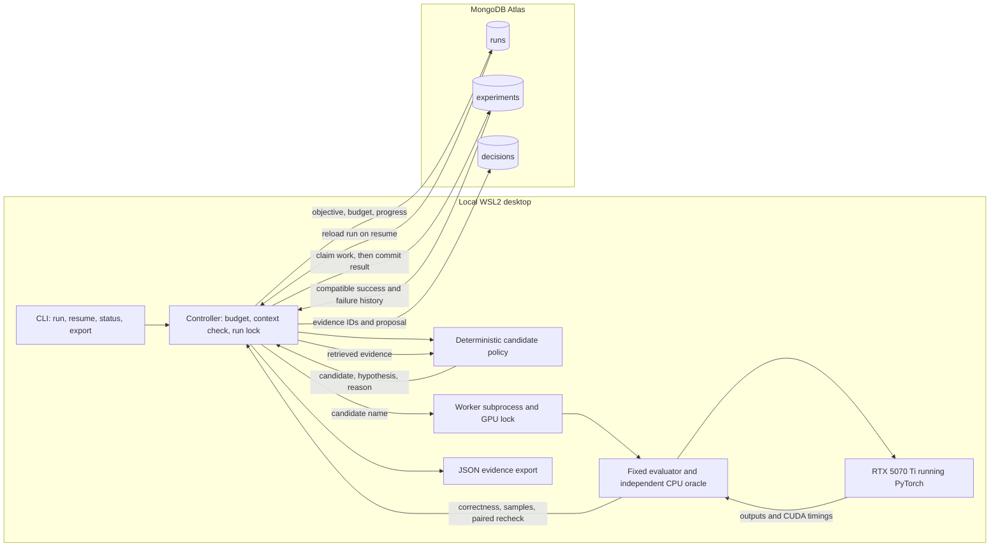

# Atlas GPU Harness

**GPU experiments that remember their mistakes and survive a controller crash.**

A GPU optimization run has just finished an experiment when its controller dies. If progress lived only in that process, the next run can pay to repeat the same work. There is a second trap: a promising implementation can return the wrong answer, or a noisy timing sample can make it look like a breakthrough. An optimizer needs to preserve what it has proved and use that evidence in its next decision.

Atlas GPU Harness makes that loop concrete: **check exact correctness → measure CUDA execution → commit the evidence to MongoDB Atlas → retrieve it before choosing the next experiment.** We built a small Python CLI around a real RTX 5070 Ti and five predefined PyTorch candidates for one exact top-k workload.

The demonstration already worked: an intentional crash preserved the committed baseline without a rerun; an incorrect candidate was rejected before timing; and a later run retrieved that failure and avoided repeating it. The paired measurements did not establish a speedup. Preserved work and evidence changing future behavior are the demonstrated outcomes.

[Verified results](EVIDENCE.md) · [System design and Atlas queries](ARCHITECTURE.md) · [Live demo](DEMO.md) · [Original contributions](NEW_WORK.md) · [Attribution](ATTRIBUTION.md)

## Hackathon fit

**Primary target: Statement 2 — Long Horizon Engineering**, from the supplied Harness Engineering & Model Wrangling participant guide, October 11, 2026.

| Track requirement | What this prototype demonstrates |
| --- | --- |
| Preserve coherent memory through a long task | Atlas stores experiment results and decision references outside the controller process. A restart reconstructs progress from those records. |
| Learn from hard metric signals | Exact correctness controls eligibility; CUDA samples record performance; a stored tie failure changes later candidate selection. |
| Keep working toward a goal | The controller resumes the same run, honors its evaluation budget, and stops when the budget or eligible candidates are exhausted. |

This is a focused demonstration of those mechanisms. The current policy is deterministic; there is no LLM, multi-day run, or billion-token memory demonstration. The fixed policy does not rewrite its rules or architecture, so Recursive Harnessing and the Raindrop RSI prize are not demonstrated by this build. Track acceptance is the judges' decision.

**Finalist eligibility also requires the event-provided Atlas Sandbox cluster.** Actual Atlas reads and writes are verified; membership of the supplied cluster in the event's Sandbox project still needs a visual check. This repository is public. An accessible one-minute video and the event submission must still be completed. The main product is the experiment controller and CLI.

## What we built

A harness is the supervisor around an optimization attempt: it chooses permitted work, enforces how work is judged, preserves results, and decides what to do next. This harness searches a small allowlist of GPU operator implementations. PyTorch executes the operators; Atlas holds durable state; the Python controller connects measurement to the next decision.



**Atlas hosts the records and retrieval. GPU execution happens on this desktop.** No model weights, GPU compute service, or vector index is hosted in Atlas by this project.

1. **Freeze the task.** Use 16,384 contiguous float32 scores, `k=64`, a fixed seed, and exact output indices ordered by descending score and ascending original index on ties.
2. **Retrieve before proposing.** Read the latest 50 compatible completed/failed experiments, then include all current-run records. Skip committed candidates in this run and known correctness failures from earlier compatible runs.
3. **Record the decision.** Store the retrieved experiment IDs, candidate, hypothesis, reason, and policy version before execution.
4. **Check before timing.** A worker compares GPU indices with an independent Python CPU oracle on ties, negative values, boundary cases, and the fixed workload. Incorrect output receives no latency result.
5. **Measure and commit.** Correct candidates receive 10 warmups and 30 CUDA event samples. Nonbaseline candidates receive 12 alternating baseline/candidate pairs. Commit the result to Atlas before updating run progress.
6. **Resume from evidence.** After a crash, count Atlas experiment records and reconstruct the best correct result. A completed experiment is skipped. An interrupted, uncommitted attempt may be retried.

The code is intentionally small: [controller](atlas_gpu_harness/__main__.py), [Atlas store](atlas_gpu_harness/store.py), [policy](atlas_gpu_harness/policy.py), and [evaluator](atlas_gpu_harness/evaluator.py).

## How Atlas tracks experiments and changes behavior

Database: `atlas_gpu_harness`. The three persistent collections answer different questions:

| Collection | Question it answers | Stored evidence |
| --- | --- | --- |
| `runs` | What are we trying to finish? | Objective, budget, status, environment and evaluation contract, compatibility hash, policy version, best correct experiment ID. |
| `experiments` | What actually happened? | Candidate, status, attempt count, correctness cases, expected/actual outputs or hashes, raw timing samples, summaries, paired recheck, errors, timestamps. |
| `decisions` | What evidence was available for this choice? | Retrieved experiment IDs, chosen candidate, hypothesis, reason, policy version, timestamp. Predicted performance is labeled unknown; measured outcomes live in the experiment record. |

An experiment's `_id` combines the run ID with a SHA-256 fingerprint of its candidate and evaluation context. MongoDB's unique `_id` prevents duplicate documents for that identity within a run. A conditional update with an owner token guards completion; writes use majority acknowledgment. These are single-document operations, not a transaction covering the whole run.

The lifecycle is `queued → running → completed / failed`. The controller deliberately persists the experiment result **before** its progress summary. Fault injection exits with code 86 in that gap. Resume reads experiment documents as the source of truth, so a stale run summary does not erase completed work.

A concrete memory example from the real exports:

- In [run 2eb9…](evidence/report-2eb9f21a2e374f358c4a42b9fbe2258d.json), direct `topk_sorted` returned `[1, 0]` for a tie case whose required indices were `[0, 1]`. The failed experiment stayed in Atlas and was never timed.
- The first decision in [run 21db…](evidence/report-21dbac5116a04dafa1ddaed17ea34030.json) retrieved four earlier experiment IDs, including that failure.
- The fixed policy skipped the known-invalid candidate and also screened out unstable sort as a related tie risk. The second run finished after three evaluations from a budget of five.

Atlas is therefore part of the execution loop: stored evidence changes which GPU work is allowed next. Successful baselines are intentionally measured again in a **new** run; deduplication of completed work applies within the same run. Decisions record selected candidates and all retrieved IDs; skipped candidates do not have separate decision documents. See [the full schema, query, and recovery sequence](ARCHITECTURE.md).

## Proof, with limits

| Pain point | Validation we performed | Observed outcome |
| --- | --- | --- |
| A crash can lose completed work | Exit after result commit, read status in a fresh process, resume the same run | Baseline remained at attempt 1; the other candidates continued. |
| An invalid implementation can become a false winner | Compare exact indices against the CPU oracle before timing | Direct top-k failed both tie fixtures, received no timing, and was excluded from best-result selection. |
| Future runs can repeat a known mistake | Start a new compatible run after storing the failure | One known-bad candidate was skipped and one related risky candidate screened out; 3/5 evaluations were used. |
| A favorable median can be mistaken for a repeatable gain | Alternate baseline and contender measurements | The recheck rejected a speedup claim despite a lower initial argsort median. |

Actual results from the four-candidate recovery run on the RTX 5070 Ti:

| Candidate | Exact correctness | Median latency | Speedup supported by paired recheck? |
| --- | --- | ---: | --- |
| Stable sort baseline | Pass | 104.1 µs | Reference |
| Stable argsort | Pass | 92.8 µs | No |
| Packed-key partial top-k | Pass | 222.9 µs | No |
| Direct PyTorch top-k | Fail on ties | Not timed | Ineligible |

The packed-key candidate encodes score order and tie index in a 64-bit key, then uses PyTorch top-k. It passed the checks and was slower on this workload. The report retains that negative result. A selected `best_experiment` is the correct candidate with the lowest measured median; that field alone does not establish a repeatable speedup.

Five tests passed: four controller/store tests using test doubles, plus one real CUDA property test covering 56 small packed-key cases. Real GPU and Atlas execution are documented separately in [EVIDENCE.md](EVIDENCE.md), with [raw public exports](evidence/). No GPU-hour savings, dollar savings, broad workload improvement, or long-duration reliability claim has been measured.

## Why this harness alongside existing frameworks?

The reason to choose this prototype is to inspect and reproduce the entire path from **exact GPU output → durable experiment evidence → next permitted action**. The distinctive work is the integration and its task-specific correctness rules. Tracking, persistence, and optimization frameworks already provide valuable building blocks:

| Existing tool | What it already provides | Our design choice for this prototype |
| --- | --- | --- |
| [LangGraph](https://docs.langchain.com/oss/python/langgraph/persistence) | Checkpointed thread state, persistent memory, recovery and continuity. | It could host this workflow. A small CLI controller is sufficient for five fixed candidates; the GPU evaluator, compatibility rules, and failure policy would still be needed. |
| [Optuna](https://optuna.readthedocs.io/en/stable/tutorial/20_recipes/001_rdb.html) | Persistent optimization studies with trial history and resume; [samplers and pruners](https://optuna.readthedocs.io/en/stable/tutorial/10_key_features/003_efficient_optimization_algorithms.html) guide larger searches. | The current space is a short explicit allowlist. Exact-output eligibility and Atlas evidence-to-decision links are the work we needed to demonstrate. A larger search could use Optuna. |
| [MLflow](https://www.mlflow.org/docs/latest/tracking/) | Tracking for runs, parameters, metrics, code versions, and artifacts. | It could track these results. Here, Atlas records directly drive recovery and candidate filtering inside the controller. |

We reused **PyTorch, PyMongo, filelock, and python-dotenv**, plus mongomock for focused tests. The installed CUDA PyTorch environment gave us a working evaluator without installing a compiler or a full inference framework. See [ATTRIBUTION.md](ATTRIBUTION.md).

## What to show the judges

The supplied guide weights round one as follows; round two weights all four categories equally.

| Criterion | Evidence to show |
| --- | --- |
| Impact potential — 20% | The concrete risks of lost experiments, repeated incorrect work, and false performance claims; show the preserved baseline and remembered rejection. Broader compute savings are an intended benefit. |
| Technical demo — 35% | A real GPU result committed to Atlas, deliberate controller exit, fresh status read, and resume with unchanged baseline attempt count. |
| Creativity — 15% | A correctness failure becomes control input for the next run, with inspectable links from the decision back to experiment records. |
| Implementation difficulty — 30% | Independent oracle, CUDA measurements, packed-key candidate, stable experiment identity, guarded completion, subprocess isolation, and reconstruction after a crash. |

The [three-minute demo](DEMO.md) makes the implementation visible. [NEW_WORK.md](NEW_WORK.md) identifies the code built during the event. PyTorch supplies the GPU operators and CUDA events; the policy is deterministic.

## Reproduce the demo

Verified environment: WSL2, RTX 5070 Ti (16,303 MiB VRAM, compute capability 12.0), driver 591.86, Python 3.11.14, PyTorch 2.8.0+cu128. The driver reports support for CUDA 13.1; the installed PyTorch wheel uses CUDA 12.8. `nvcc` was absent. See the [preflight manifest](evidence/preflight.json).

On another CUDA system, install a suitable PyTorch wheel using the [official selector](https://pytorch.org/get-started/locally/), then install the project dependencies. On the verified desktop we reused the existing environment:

```bash
cd /mnt/c/Users/henry/Documents/ChatGPT/gpu-engineer-agent
/home/henryl/miniconda3/envs/henry_benchmark/bin/python -m venv --system-site-packages .venv
.venv/bin/python -m pip install -r requirements-dev.txt
.venv/bin/python -m atlas_gpu_harness preflight
.venv/bin/python -m atlas_gpu_harness baseline
```

For Atlas:

1. Join the **event-provided Atlas Sandbox** using the invitation and select that project.
2. Create a database user with `readWrite` access to `atlas_gpu_harness`, and allow this desktop's public outbound IP in the project's IP Access List.
3. Copy the cluster's Python driver URI, replace its credential placeholders, and save it as `MONGODB_URI=...` in the ignored `.env` file. URL-encode special characters in the password. `.env.example` contains placeholders only.
4. Run the live ping and write/read/delete check. Open Data Explorer at `atlas_gpu_harness` to inspect the records.

```bash
.venv/bin/python -m atlas_gpu_harness atlas-check
.venv/bin/python -m unittest discover -s tests -v

# Intentionally exits 86 AFTER committing the first result.
.venv/bin/python -m atlas_gpu_harness run --budget-evals 4 --fault-after-commit
# Copy its printed RUN_ID into the following commands.
.venv/bin/python -m atlas_gpu_harness status --run-id RUN_ID
.venv/bin/python -m atlas_gpu_harness resume --run-id RUN_ID
.venv/bin/python -m atlas_gpu_harness export --run-id RUN_ID

# A new run can use compatible failure history from earlier runs.
.venv/bin/python -m atlas_gpu_harness run --budget-evals 5
```

Existing failure history can cause a new run to finish below its budget. To show the original rejection, inspect the saved failed experiment; do not delete history just to reproduce it. The 59-second captioned backup can be recreated with [scripts/make_demo_video.py](scripts/make_demo_video.py); [DEMO.md](DEMO.md) covers recording and submission.

## Boundaries and next steps

This is one operator, one primary workload, one desktop, and a fixed five-candidate policy. Local locks require the same host and artifacts directory. An interrupted uncommitted evaluation may execute again; completed results are committed idempotently within a run. There is no distributed scheduler or exactly-once GPU execution guarantee.

Compatibility uses GPU name, compute capability, Torch/CUDA versions, evaluator version, and the complete evaluation contract. Driver, Git revision, and Python version are recorded but excluded from that hash. Meaningful evaluator changes require a version bump; the current hash is not a complete environment or source-code identity. Historical retrieval is bounded to 50 compatible terminal experiments plus current-run records.

The next useful extensions would be source-complete compatibility checks, a larger workload suite, and a constrained model proposer or established search framework using the same fixed evaluator. Those extensions are not part of the demonstrated build.
