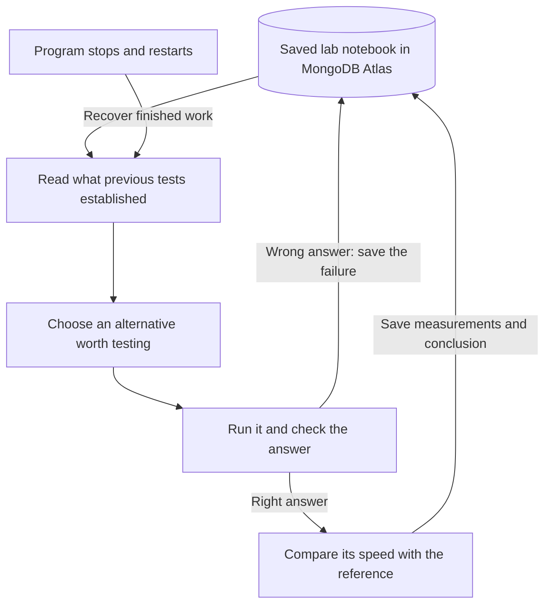

# Atlas GPU Harness

**Goal: help large language models run on consumer GPUs through measured inference experiments.**

An engineer wants a capable language model on a desktop, but its model weights and conversation state exceed the graphics card's memory. Moving work into system RAM or compressing it may help it fit, while also changing speed or answer quality. The engineer needs evidence about which configuration actually works on that machine.

The intended inspiration is [Strata](https://github.com/Niko1221/Strata) and [Project Maya](https://github.com/mw00/project-maya), which use consumer hardware for large-model inference. Our proposed contribution is a harness that evaluates inference configurations against a memory budget, a quality requirement, and repeated speed measurements, retaining the evidence in MongoDB Atlas. [The corrected goal and experiment protocol](CONSUMER_GPU_PLAN.md) explain the missing integration and the baseline required to establish that outcome.

**Implemented today:** an experiment manager with a saved lab notebook, tested on a standalone PyTorch top-k calculation. It checks each answer, measures correct alternatives against a reference, saves evidence in Atlas, and uses saved failures to avoid repeated work. Strata/Maya integration, actual LLM inference evaluation, and model memory reduction are not implemented. No LLM output quality has been measured.

**Measured subsystem result:** in two controlled comparisons on a real RTX 5070 Ti, access to previous evidence reduced attempts from **4 to 3 — 25% fewer attempts — while checking the same three correct alternatives**. One known-invalid test was avoided in each comparison. This measures less repeated experimental work; it does not establish lower LLM memory use, better LLM answers, or faster inference.

[Experiment design and results](EXPERIMENTS.md) · [Hackathon review](HACKATHON_REVIEW.md) · [Three-minute demo](DEMO.md) · [Technical system design](ARCHITECTURE.md) · [Original work](NEW_WORK.md)

## Are we writing faster GPU kernels?

The user-facing goal is usable LLM inference within a consumer GPU's memory budget while preserving measured answer quality. A GPU kernel is a program executed on the GPU; writing or tuning kernels is one possible implementation technique. **This build manages and evaluates experiments. It does not generate new CUDA or Triton kernels.** It tests five predefined implementations composed from PyTorch operations, including a packed-key alternative we wrote using those operations. A kernel-writing agent could supply future alternatives, but it is not part of the demonstrated system.

So far, the measured improvement is in the experiment workflow: fewer repeated tests. Faster GPU calculation remains an unachieved outcome. We should present both the useful working mechanism and that limitation clearly.

## The problem, solution, and proof

The intended user is an engineer running repeated GPU optimization experiments. A GPU is the processor that performs many AI calculations. The small demonstration here asks it to find the 64 highest-scoring positions among 16,384 scores, with a fixed rule for tied scores.

| Problem | What the manager does | What we observed |
| --- | --- | --- |
| Repeat a mistake already discovered | Read the saved failure before choosing the next test | With memory: 3 attempts. Without it: 4. Same three correct alternatives checked in both repeated comparisons. |
| Lose progress after the program stops | Save each result before moving on; reload it on restart | After a deliberate stop, the completed reference test remained at one attempt while unfinished work continued. |
| Treat a wrong answer as an improvement | Compare every answer with an independent reference calculation | A method returned tied positions in the wrong order. It was rejected before timing. |
| Mistake timing noise for progress | Warm both methods, repeat measurements, and alternate which is timed first | An apparent initial improvement did not survive paired checks. No speedup was claimed. |

The broader problem is real: [Anthropic describes lost continuity and repeated recovery work in long-running agents](https://www.anthropic.com/engineering/effective-harnesses-for-long-running-agents), and [KernelBench evaluates GPU optimization on both correctness and speed](https://arxiv.org/abs/2502.10517). These support the engineering need; our small experiment does not establish customer demand, production savings, or return on investment.

## How it works, in ordinary language



The experiment manager runs on the desktop. PyTorch performs the GPU calculations. Atlas stores the notebook in three collections:

| Atlas collection | Plain-language purpose |
| --- | --- |
| `runs` | The goal, testing budget, environment, and progress. |
| `experiments` | What was tried, whether its answer was correct, measurements, and errors. |
| `decisions` | What was chosen next, why, and which earlier test records were available. |

Atlas is used before the next decision, so its records change behavior. It does not host our GPU computation. [ARCHITECTURE.md](ARCHITECTURE.md) provides the exact data model, ownership checks, recovery sequence, and Data Explorer filters.

## How we measured improvement fairly

We use three separate references so that a correct answer, a faster calculation, and a more efficient experiment process cannot be confused:

| Reference | How it is established | What it can prove |
| --- | --- | --- |
| Correct answer | An independent CPU implementation sorts by score and then original index. | Whether a GPU alternative satisfies the fixed answer rules. CPU time is not used as the GPU speed baseline. |
| GPU speed baseline | PyTorch stable sort on the same GPU, selecting its first 64 indices. It is fixed before comparison, warmed, and remeasured next to each alternative. | Whether the alternative is repeatably faster than this specified reference. |
| Workflow comparison | The same experiment manager with access to previous-run evidence disabled. Current-run memory stays enabled. | Whether prior evidence reduces attempts while preserving the same validated alternatives. |

We tested the notebook's contribution by changing **only access to previous-run evidence**. Both versions used the same program, five allowed methods, input, GPU, answer checks, timing rules, and testing budget. Both could remember results within their current run.

| Scientific design element | What we did |
| --- | --- |
| Hypothesis | Remembering a known failure avoids repeating it while preserving the same validated alternatives. |
| Comparison | Previous-run memory disabled versus enabled, using the same frozen set of real Atlas records. |
| Primary measure | Actual test attempts needed to assess the same three correct alternatives; fewer is better. |
| Quality safeguards | Same correct alternatives evaluated; no incorrect result accepted; no worker errors. |
| Repetition | Run without/with memory, then reverse the order and repeat. |
| Result | 4 → 3 attempts in both comparisons: `(4 - 3) / 4 = 25%` fewer. |

This is conditional on relevant prior evidence being available. Its original acquisition cost is excluded. The five-attempt budget is not the comparison denominator. The measured elapsed times also decreased, but two short comparisons do not establish general runtime or GPU-cost savings. See [raw records](evidence/harness-ablation.json), the [recomputed summary](evidence/experiment-summary.json), and the full [experimental design](EXPERIMENTS.md).

We separately tested **whether the calculation became faster**. After fixing warmup for both reference and alternative, stable argsort's median paired effect ranged from **6.8% slower to 1.1% faster** across five runs; it won only 3–6 of 12 comparisons in each run. That inconsistent direction does not support a speedup. The policy currently uses correctness failures to filter a fixed search order; latency is measured and reported, not used to invent a new search strategy.

## Which track does this fit?

**Statement 2 — Long Horizon Engineering is the closest fit.** The demonstrated part is preserving progress beyond one running program and using measured evidence in later decisions.

There is no long-context language model in this build. Its policy is deterministic, its search has five predefined methods, and its demonstration lasts minutes. Historical retrieval is bounded to 50 compatible completed/failed experiments plus the current run's records. The prototype does not establish billion-token memory, multi-day reasoning, or autonomous invention of GPU kernels.

The fixed rules do not rewrite themselves, so Recursive Harnessing is not demonstrated. Track acceptance is the judges' decision. The event also requires the supplied **Atlas Sandbox** for finalist eligibility: real Atlas reads/writes are verified, but project membership still needs visual confirmation. The public repository is ready; accessible video upload and event submission remain outstanding.

## Why build this when other tools exist?

| Existing tool | What it provides | Our narrow contribution |
| --- | --- | --- |
| [LangGraph](https://docs.langchain.com/oss/python/langgraph/persistence) | Persistent state, memory, and recovery. | A concrete GPU experiment loop whose answers, measurements, remembered failures, and restart behavior can be inspected together. |
| [Optuna](https://optuna.readthedocs.io/en/stable/tutorial/20_recipes/001_rdb.html) | Persistent optimization studies and trial history. | Exact answer rules and failure reuse for a small predefined set; a larger search could use Optuna. |
| [MLflow](https://www.mlflow.org/docs/latest/tracking/) | Tracking for experiments, metrics, and artifacts. | Stored evidence directly controls which experiment this program performs next. |

These frameworks could support an expanded version. We reused PyTorch, PyMongo, filelock, and python-dotenv to produce one working path quickly. The original contribution is the integration, evaluator, recovery behavior, packed-key alternative, and controlled comparison—not a claim to have invented persistence. See [ATTRIBUTION.md](ATTRIBUTION.md) and [NEW_WORK.md](NEW_WORK.md).

## What the judges can observe

The supplied guide weights the first round as impact 20%, technical demo 35%, creativity 15%, and implementation difficulty 30%; round two weights them equally. The presentation should show the user's problem, the fair comparison, and the working result before discussing internals.

Our strongest proof is **the same correct alternatives assessed with fewer repeated tests**, supported by real Atlas records and a live restart. Technical depth comes from independent answer checking, GPU measurement, guarded result writes, and recovery. Impact remains narrow: no customer or production savings study has been performed. [HACKATHON_REVIEW.md](HACKATHON_REVIEW.md) documents the organizer guidance and relevant public skills reviewed, their application, and the remaining competitive gaps.

## Run it yourself

Verified machine: WSL2, RTX 5070 Ti, 16,303 MiB VRAM, Python 3.11.14, PyTorch 2.8.0+cu128. The driver supports CUDA 13.1; the PyTorch wheel uses CUDA 12.8. No CUDA compiler was installed. See [the current manifest](evidence/preflight-v3.json).

Use a working CUDA PyTorch environment. On this desktop we reused an existing installation:

```bash
cd /mnt/c/Users/henry/Documents/ChatGPT/gpu-engineer-agent
/home/henryl/miniconda3/envs/henry_benchmark/bin/python -m venv --system-site-packages .venv
.venv/bin/python -m pip install -r requirements-dev.txt
.venv/bin/python -m atlas_gpu_harness preflight
```

On another machine, install an appropriate wheel using the [official PyTorch selector](https://pytorch.org/get-started/locally/). Join the event's Atlas Sandbox, create a database user with `readWrite` on `atlas_gpu_harness`, and allow the desktop's public outbound IP. Save its driver URI as `MONGODB_URI=...` in the ignored `.env` file; `.env.example` contains placeholders.

```bash
.venv/bin/python -m atlas_gpu_harness atlas-check
.venv/bin/python -m unittest discover -s tests -v

# Deliberately exits 86 after saving the first result.
.venv/bin/python -m atlas_gpu_harness run --budget-evals 4 --fault-after-commit
# Substitute the printed run ID below.
.venv/bin/python -m atlas_gpu_harness status --run-id RUN_ID
.venv/bin/python -m atlas_gpu_harness resume --run-id RUN_ID
.venv/bin/python -m atlas_gpu_harness export --run-id RUN_ID

# Compare access to one compatible saved run, without altering its records.
.venv/bin/python scripts/measure_harness.py \
  --seed-run-id SEED_RUN_ID --output artifacts/new-comparison.json

# Recompute the published numbers without Atlas or GPU access.
.venv/bin/python scripts/summarize_experiments.py
```

The live comparison needs a completed, compatible seed containing the observed tie failure; [EXPERIMENTS.md](EXPERIMENTS.md) gives the published IDs. Five tests passed after the measurement correction, followed by a real recovery run and four real comparison runs. Existing failure history can cause a run to finish below budget; inspect the original failure instead of deleting it to stage the demo.

## Scope of the guarantees

One desktop, one primary workload, a fixed policy, and local file locks. An interrupted experiment whose result was not saved can run again. The record identity prevents duplicate committed work within a run; it does not guarantee exactly-once GPU execution.

The compatibility hash includes the GPU, Torch/CUDA versions, evaluator version, and evaluation contract, but excludes recorded driver, Git revision, and Python metadata. Evaluator changes require a version bump. Version 3 corrects paired warmup; version-2 reports remain historical evidence. The lowest initial median is not a confirmed speedup, and remembered failures outside the bounded retrieval window may not influence later runs.
